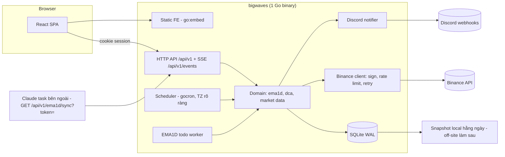

# Rebuild Wavetrade → bigwaves (Go + SQLite + React)

> Plan tổng. Chi tiết backend ở [01-backend-go.md](01-backend-go.md), frontend ở
> [02-frontend-react.md](02-frontend-react.md), di chuyển dữ liệu + cutover ở
> [03-migration-cutover.md](03-migration-cutover.md).

## 1. Bối cảnh

| | Hiện tại | Mục tiêu |
|---|---|---|
| Backend | Rails 8 + Sidekiq + Redis + PostgreSQL (`~/Workspace/VH/wavetrades/wavetrade`) | **Go**, 1 binary, scheduler chạy trong process |
| DB | PostgreSQL, 28 bảng (Ridgepole) | **SQLite** (WAL), 1 file; backup off-site làm sau (D5) |
| Frontend | React 18 + MUI 6 + Jotai (`~/Workspace/VH/wavetrades/wavetrade-app`), 23 route, ~15k LOC | React 19 + TS strict, cấu trúc theo feature, TanStack Query/Table, UI mới |
| Deploy | Puma/systemd + nginx, Sidekiq qua cron, `dist/` commit vào git | 1 binary Go nhúng sẵn FE build (`go:embed`), systemd + Caddy/nginx |
| Repo mới | `~/Workspace/VH/bigwaves` (monorepo: `backend/`, `frontend/`) | |

Nguồn sự thật về nghiệp vụ (đọc trước khi port từng phần):

- `wavetrade/docs/*.md` (viết 2026-10-24, chính xác nhất — đặc biệt `ema1d.md`, `ema1d-strategy.md`, `exchanges.md`, `schedules.md`, `cleanup-candidates.md`).
- `wavetrade/.claude/plans/*` và `wavetrade-app/.claude/plans/*` (spec DCA / EMA1D có shape JSON; spec EMA / Grid chỉ để tham khảo — đã bỏ khỏi phạm vi).
- `wavetrade/test/fixtures/files/ema1d/expected_status.json` — golden data để kiểm tra engine EMA1D bản Go.
- **Bỏ qua** `README.md`, `notes.md`, `Trading System.md`, `CLAUDE.md` cũ của Rails — đã lỗi thời (LsTrade, BuaMargin, JWT… không còn).

## 2. Kiến trúc đích



Nguyên tắc:

1. **Một process, một writer.** SQLite + single binary → không cần Redis, không cần job queue ngoài. Không scale ngang (không cần — 1 user).
2. **Engine thuần tách khỏi IO.** Logic tín hiệu/sizing/reconcile là hàm thuần, test bằng golden data; IO (Binance, DB, Discord) ở rìa qua interface.
3. **Tiền là decimal, không bao giờ float.** `shopspring/decimal` trong Go, TEXT trong SQLite, string trong JSON.
4. **Contract-first.** OpenAPI 3.1 là nguồn sự thật; sinh TS types cho FE, kiểm tra handler bằng test.
5. **Không bao giờ hai hệ thống cùng đặt lệnh** lên một tài khoản Binance (xem 03).

### 2.1 Cấu trúc repo (monorepo)

```
bigwaves/
├─ api/
│  └─ openapi.yaml          # contract duy nhất giữa BE và FE — BE sinh server interface, FE sinh TS types
├─ backend/                 # Go module riêng (go.mod ở đây) — chi tiết: 01-backend-go.md §2
│  ├─ cmd/{bigwaves,bwctl}/
│  ├─ internal/
│  │  └─ web/dist/          # FE build được copy vào lúc build release (gitignore), nhúng bằng go:embed
│  └─ testdata/
├─ frontend/                # Vite + React, package.json riêng — chi tiết: 02-frontend-react.md §3
│  ├─ src/
│  └─ public/
├─ deploy/                  # systemd unit, Caddy/nginx config, script backup, .env.example
├─ docs/                    # tài liệu vận hành + nghiệp vụ (port từ wavetrade/docs, bỏ phần đã loại)
├─ archive/                 # (gitignore) CSV dữ liệu các bảng bị bỏ khi import
├─ .github/workflows/       # ci-backend.yml, ci-frontend.yml (chạy theo path filter), release.yml
├─ .claude/plans/           # các plan này
├─ Makefile                 # gen (sqlc + oapi-codegen + openapi-typescript), dev, test, lint, build, release
├─ CLAUDE.md                # lệnh + quy ước cho cả repo
└─ README.md
```

Vì sao monorepo thay vì 2 repo như cũ (`wavetrade` + `wavetrade-app`):

- **Một contract**: sửa `api/openapi.yaml` → `make gen` → BE và FE cùng đổi trong **một commit**; CI bắt lệch ngay (không còn cảnh FE gọi endpoint BE đã đổi).
- **Một artifact**: release = 1 binary Go đã nhúng FE, không còn commit `dist/` vào git và deploy 2 nơi.
- Vẫn tách bạch: `backend/` và `frontend/` có toolchain riêng (`go.mod` / `package.json`), CI chạy theo path filter nên sửa FE không chạy test Go và ngược lại.

Lúc dev chạy 2 process: `make dev` = `go run ./backend/cmd/bigwaves` (:8080) + `vite` (:5173, proxy `/api`, `/auth` → :8080) — cùng origin nên cookie session hoạt động như production.

## 3. Phạm vi — ĐÃ CHỐT (2026-10-26)

| Nhóm tính năng | Quyết định | Pha |
|---|---|---|
| Master data: Pair + Coin (gồm **mô tả markdown**) | ✅ Port. **Một màn Pairs duy nhất**: mô tả coin xem/sửa trong drawer của pair; không có màn Coins riêng (chốt 2026-10-26) | P1 |
| Markets | ❌ Bỏ màn + API CRUD. Giữ bảng `markets` với 1 dòng seed `BINANCE` để sau thêm sàn khác (chốt 2026-10-26) | — |
| AppSetting | ✅ Port nhưng **tách theo chiến lược**: cấu hình EMA1D sửa ở màn EMA1D, cấu hình DCA ở màn DCA; không còn màn "Cài đặt" chung (chốt 2026-10-26) | P2/P3 |
| Auth Auth0 (OIDC + cookie session) | ✅ Port | P1 |
| Binance spot + cross margin | ✅ Port, viết lại client sạch | P1 |
| Jobs giá / lãi suất / step size | ✅ Port | P1 |
| Discord notify (lệnh, cảnh báo EMA1D, báo cáo ngày) | ✅ Port, webhook vào env | P1 |
| **EMA1D-EXIT** (menu `/ema1d`: signal, sync, todo queue, monitor, snapshot, daily check — gồm code chưa commit, D3) | ✅ Port đầy đủ, ưu tiên cao nhất | P2 |
| Discord relay (`/discord_messages/send_message`) | ✅ Giữ, đặt sau token | P2 |
| **DCA** | ✅ Port | P3 |
| Grid (+ suggest step ATR) | ❌ Bỏ | — |
| EMA Settings (`/ema-settings`, chiến dịch theo pair có budget + TP/SL — **khác** EMA1D-EXIT) | ❌ Bỏ | — |
| EMA legacy H1/H4/D1 (tracking, auto-run) | ❌ Bỏ | — |
| Cảnh báo EMA cross H1/H4/D1, EMA Scores, EMA Statistics + trade histories, biến động giá ngày/tháng | ⏸ Tạm bỏ qua — ngoài phạm vi, xem lại sau | — |
| Position sizing calculator | ❌ Bỏ | — |
| Market cap (CoinGecko) | ❌ Bỏ (bỏ cả cột `coins.market_cap`) | — |
| Tags / coin_tags | ❌ Bỏ | — |
| OKX / MEXC / Gate.io / Bitfinex, check_patterns, daily_gotten_trades, mailer, stocks | ❌ Bỏ (dead); giữ interface `Exchange` để thêm sàn sau | — |

Dữ liệu của các phần bị bỏ: export CSV vào `archive/` khi import (xem 03), không đưa vào SQLite.

**Các quyết định:**

- ~~D1. Phạm vi~~ — **ĐÃ CHỐT (2026-10-26)**: bảng trên.
- ~~D2. Auth~~ — **ĐÃ CHỐT (2026-10-26): Auth0** (OIDC + cookie session), không tự quản password. Chi tiết ở [01-backend-go.md §5](01-backend-go.md#5-auth--bảo-mật).
- ~~D3. Code chưa commit trên `ema1d-daily-check`~~ — **ĐÃ CHỐT (2026-10-26): có port** (daily check, candles 1D/4H, signals, daily report, bảng `ema1d_candles`, `ema1d_daily_checks`, các rake task tương ứng). Nên commit phần này bên Rails trước khi bắt đầu P2 để có mốc so sánh cố định cho parity test và shadow run.
- ~~D4. UI kit~~ — **ĐÃ CHỐT (2026-10-26): shadcn/ui + Radix + Tailwind CSS v4**, không dùng MUI. Lý do: UI mới thật sự (thoát giao diện Material), tùy biến tới từng pixel cho dashboard dày số liệu, dark mode bằng CSS variables, bundle nhẹ, component nằm trong repo nên agent sửa trực tiếp được. Bảng dùng TanStack Table (không cần MUI DataGrid). Chấp nhận F0 dài thêm ~2–3 ngày để dựng `shared/ui`.
- ~~D5. Backup~~ — **HOÃN (2026-10-26): làm sau**, không nằm trong các pha P0–P3. Tạm thời chỉ giữ mức tối thiểu ở [01-backend-go.md §11](01-backend-go.md#11-đóng-gói--vận-hành) (snapshot `.backup` hằng ngày ra đĩa local). Litestream + nơi lưu off-site sẽ chốt trong một pha riêng.

## 4. Lộ trình

```mermaid
gantt
  dateFormat  YYYY-MM-DD
  title Lộ trình (ước lượng, 1 dev + Claude Code)
  section Nền tảng
  P0 Repo, CI, OpenAPI, skeleton BE/FE      :p0, 2026-10-27, 5d
  section Backend
  P1 Core: DB, auth, Binance, jobs, notify  :p1, after p0, 10d
  P2 EMA1D port + parity test               :p2, after p1, 15d
  P3 DCA                                    :p3, after p2, 5d
  section Frontend
  F0 Design system, shell, auth, data layer :f0, after p0, 10d
  F1 Master data + Jobs                     :f1, after p1, 4d
  F2 EMA1D dashboard                        :f2, after p2, 8d
  F3 DCA screens                            :f3, after p3, 4d
  section Chuyển đổi
  M1 Tool PG → SQLite + kiểm đối soát        :m1, after p2, 4d
  M2 Shadow run (dry-run song song Rails)   :m2, after m1, 7d
  M3 Cutover + theo dõi                      :m3, after m2, 3d
```

Thứ tự ưu tiên: **EMA1D chạy được an toàn trên Go trước**, các chiến lược khác sau. Cutover chia hai đợt: đợt 1 EMA1D + core (Rails vẫn chạy DCA với EMA1D tắt), đợt 2 DCA — xem 03. Grid / EMA Settings đang chạy bên Rails (nếu có) phải được đóng hết trước khi tắt Rails.

## 5. Tiêu chí hoàn thành (Definition of Done) cho mỗi pha

- `go test ./...` + `golangci-lint` + FE `typecheck/lint/vitest` xanh trên CI.
- Endpoint có trong OpenAPI, TS types được sinh lại, FE không còn `any`.
- Mọi job có log có cấu trúc (slog), có bản ghi job run, lỗi gửi Sentry + Discord có throttling theo (job, error fingerprint).
- Logic có tiền/lệnh: test với fake Binance (httptest) cho cả nhánh lỗi tạm thời, lỗi vĩnh viễn, retry, idempotent theo `clientOrderId`.
- Docs cập nhật trong `bigwaves/docs/`.

## 6. Rủi ro chính

| Rủi ro | Giảm thiểu |
|---|---|
| Engine EMA1D bản Go lệch Ruby/Python (ewm, làm tròn) → tín hiệu sai | Golden test với `expected_status.json` + so sánh song song N ngày trong shadow run |
| Hai hệ thống cùng đặt lệnh trong lúc chuyển | Cờ `TRADING_ENABLED` mặc định `false`; `clientOrderId` prefix mới `bw_`; checklist cutover tắt Rails trước khi bật Go |
| Mất dữ liệu SQLite | WAL + snapshot `.backup` hằng ngày ra đĩa local (tối thiểu). Backup off-site (Litestream) **hoãn — làm sau** (D5); trước đó hỏng ổ đĩa server = mất dữ liệu kể từ snapshot cuối, vị thế phải dựng lại từ lịch sử lệnh Binance |
| Decimal sai khi SUM trong SQL (TEXT) | Tổng hợp tiền trong Go, không dùng `SUM()` SQL cho cột tiền |
| Binance rate limit / ban IP | Rate limiter theo weight header `X-MBX-USED-WEIGHT-*`, backoff khi 429/418 |
| Lộ secret (webhook hard-code, `.env`, dump trong git cũ) | Repo mới: secret chỉ qua env/file ngoài repo, gitleaks trong CI; **rotate** webhook Discord + API key Binance khi cutover |
