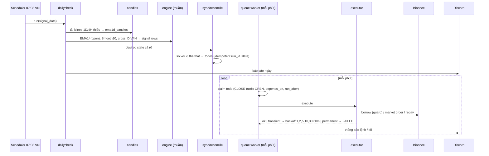

# Backend Go + SQLite

> Thuộc plan [00-overview.md](00-overview.md). Tham chiếu nghiệp vụ: `~/Workspace/VH/wavetrades/wavetrade/docs/`.

## 1. Stack

| Mảng | Chọn | Lý do |
|---|---|---|
| Ngôn ngữ | Go stable mới nhất (≥ 1.25) | |
| HTTP | `net/http` + `go-chi/chi/v5` | Middleware gọn, route group, không framework nặng |
| OpenAPI | Spec viết tay `<root>/api/openapi.yaml` + `oapi-codegen` (strict server interface) | Contract-first, FE sinh types từ cùng file |
| SQLite driver | `modernc.org/sqlite` (pure Go, không CGO) | Cross-compile dễ, 1 binary tĩnh |
| Query | `sqlc` | SQL thuần, type-safe, không ORM |
| Migration | `pressly/goose` (nhúng `embed.FS`, chạy lúc khởi động) | |
| Decimal | `shopspring/decimal` | Thay `BigDecimal` |
| Scheduler | `go-co-op/gocron/v2` (hỗ trợ timezone, singleton mode) | Thay Sidekiq + sidekiq-scheduler + Redis |
| Config | `caarlos0/env` + `.env` (chỉ dev) | |
| Log | `log/slog` (JSON ở prod) | |
| Lỗi | `getsentry/sentry-go` | |
| Auth | `coreos/go-oidc/v3` + `golang.org/x/oauth2` (Auth0), session lưu ở bảng `sessions`, cookie chỉ chứa session id | D2 đã chốt: Auth0 |
| Test | `testing` + `testify/require`, `httptest` fake Binance, SQLite temp file | |
| Lint | `golangci-lint` (govet, staticcheck, errcheck, gosec, revive) | |
| Backup | Tạm: snapshot `.backup` hằng ngày ra đĩa local. Litestream off-site **làm sau** (D5) | |

## 2. Cấu trúc thư mục

```
backend/
  cmd/
    bigwaves/            # main: HTTP server + scheduler + worker trong 1 process
    bwctl/               # CLI: migrate, import-pg, seed-ema1d, import-candles, signals, daily-check, backfill...
  internal/
    web/                 # go:embed dist/ (FE build, gitignore) + SPA fallback về index.html
    config/              # struct Config, load + validate env
    platform/
      db/                # mở SQLite, PRAGMA, writer/reader pool, tx helper, migrations/ (goose), queries/ (sqlc)
      httpx/             # router, middleware (auth, request id, recover, log, CORS, rate limit), error → JSON
      scheduler/         # đăng ký job, bảng job_runs, throttle lỗi
      notify/            # Discord webhook client, throttle
      clock/             # Clock interface (test được mốc thời gian)
      money/             # decimal helpers, làm tròn theo step/tick size
    exchange/
      exchange.go        # interface Spot, Margin, MarketData
      binance/           # client: sign, weight limiter, retry, errors, spot.go, margin.go, market.go
      binancefake/       # fake server cho test (httptest)
    auth/                # OIDC login/callback/logout, session store, middleware
    marketdata/          # market, coin (+ mô tả markdown), pair; jobs giá/lãi/step size
    config store chung   # (trong platform/db) đọc/ghi config theo strategy + lịch sử thay đổi; mỗi domain tự định nghĩa struct config của mình
    ema1d/
      engine/            # THUẦN: EMA, smooth, cross, DIV4H (fractal + RSI divergence), signal rows
      sizing/            # THUẦN: equity, % theo group/side, cap long notional
      reconcile/         # THUẦN: desired state vs positions → todos
      sync/              # parse query, gọi reconcile, lưu ema1d_syncs (idempotent run_id+date, dry_run)
      queue/             # claim todo, phụ thuộc, CLOSE trước OPEN, backoff, stuck reset
      executor/          # đặt lệnh: long buy / short borrow+sell / close; borrow guard
      monitor/ snapshot/ dailycheck/ report/ candles/
      http.go            # handler EMA1D
    dca/                 # P3: model, service, checker job, http
  testdata/
```

Quy tắc phụ thuộc: `engine`, `sizing`, `reconcile` không import DB/HTTP/exchange. Package domain phụ thuộc `exchange.*` interface, không phụ thuộc `binance` cụ thể.

## 3. SQLite — thiết kế lưu trữ

### 3.1 Cấu hình kết nối

```
PRAGMA journal_mode=WAL;
PRAGMA synchronous=NORMAL;
PRAGMA foreign_keys=ON;
PRAGMA busy_timeout=5000;
PRAGMA temp_store=MEMORY;
```

- **Writer pool:** `SetMaxOpenConns(1)`, mọi transaction ghi mở bằng `BEGIN IMMEDIATE` (tránh lỗi `SQLITE_BUSY` khi nâng cấp khoá giữa chừng).
- **Reader pool:** nhiều connection, `mode=ro` (query_only).
- Không giữ transaction ghi trong lúc gọi Binance/Discord. Mẫu chuẩn: tx ngắn ghi trạng thái `RUNNING` → gọi sàn ngoài tx → tx ngắn ghi kết quả. (Sửa luôn bug cũ của `CloseSettingService` bọc lệnh sàn trong DB transaction.)

### 3.2 Ánh xạ kiểu từ PostgreSQL

| PostgreSQL | SQLite | Ghi chú |
|---|---|---|
| `decimal(16,8)`, `decimal(20,8)`, `decimal(8,4)` | `TEXT` (chuỗi decimal chuẩn hoá) | Đọc/ghi qua kiểu `money.Dec` implement `sql.Scanner/driver.Valuer`. **Không SUM/so sánh số trong SQL** trên cột này; nếu cần lọc/sort theo số ở SQL thì thêm cột phụ `*_f REAL` chỉ để sort, không dùng tính toán |
| `float` (ema1d_candles) | `REAL` | Giữ như Rails (khớp research Python) |
| `timestamp` | `TEXT` RFC3339Nano UTC | Luôn UTC; hiển thị theo TZ ở FE |
| `date` | `TEXT` `YYYY-MM-DD` | |
| `jsonb` | `TEXT` + `CHECK(json_valid(col))` | Truy vấn bằng `json_extract` khi cần |
| `text[]` (`users.ips`) | `TEXT` JSON array | |
| `boolean` | `INTEGER` 0/1 | |
| enum string (enumerize) | `TEXT` + `CHECK(col IN (...))` | Kiểu Go `type TodoStatus string` + const |
| partial unique index | giữ nguyên (SQLite hỗ trợ `CREATE UNIQUE INDEX ... WHERE`) | vd `ema1d_todos (pair,action,side,signal_date) WHERE status <> 'CANCELLED'` |
| `FOR UPDATE SKIP LOCKED` | Không cần | 1 worker, claim bằng `UPDATE ... SET status='RUNNING' WHERE id=(SELECT ...) RETURNING *` trong `BEGIN IMMEDIATE` |
| soft delete `deleted_at` | giữ | |

### 3.3 Schema

Viết lại từ `db/schemas/*.schema` (Ridgepole), **không** từ `structure.sql` (stale). Đổi so với Rails:

- **Tách `ema_trades`**: bảng này đang dùng chung cho legacy EMA, EMA Settings và EMA1D (~10 cột chỉ EMA1D dùng, `close_price` mang 2 nghĩa). Bản mới:
  - `ema1d_positions` (vị thế EMA1D: side, entry/exit, ref price, fee, interest, notional, exit_rule, signal_date…), `ema1d_orders` (từng lệnh sàn: clientOrderId, side, qty, avg price, fee, raw JSON).
  - Dòng của EMA Settings và EMA legacy không import (D1 đã bỏ) — chỉ archive CSV.
  - Tách `target_close_price` và `close_fill_price`.
- **`app_settings` → `strategy_configs`** (tách theo chiến lược): mỗi dòng = 1 strategy (`ema1d`, `dca`), cột `config` là JSON đã validate, `version`, `updated_at`. Mỗi domain có struct riêng (`ema1d.Config`: budget USDT, % CORE/SENSITIVE × LONG/SHORT, `enabled`, `pause_open`, `max_entry_age_days`, ngưỡng margin level cảnh báo, giờ daily check…; `dca.Config`: giới hạn vốn…) với giá trị mặc định + validate. Chỉ mang sang các key `EMA1D_*` còn dùng; các key `EMA_{H1,H4,D1}_*` và ~26 key mồ côi bỏ hết. Cache trong memory, invalidate khi PATCH.
- **`config_changes`**: lịch sử mỗi lần sửa config (strategy, trước, sau, user, thời điểm) — tham số này ảnh hưởng tiền thật nên cần truy vết. PATCH dùng `version` để chặn ghi đè đồng thời (409).
- **`job_runs`** (thay `job_logs`): job, started_at, finished_at, status, error, duration; retention 30 ngày.
- **`error_events`** (thay `errors`): fingerprint = job + loại lỗi + message chuẩn hoá (không chỉ class như cũ), dùng để throttle Sentry/Discord.
- **`sessions`**: id, user_id, created_at, expires_at, ip, user_agent.
- **`exchange_orders`** dùng chung DCA/EMA1D nếu hợp lý — lưu mọi lệnh sàn với `client_order_id UNIQUE`, là nguồn để đối soát.
- Bảng giữ: `users`, `sessions`, `strategy_configs`, `config_changes`, `markets` (chỉ seed `BINANCE`, không có API/màn), `coins` (bỏ cột `market_cap`, giữ `description` markdown; coin được **tự tạo** từ base asset khi tạo pair, vd `SUNUSDT` → coin `SUN`), `pairs` (bỏ `is_auto_trade`, `is_auto_ema_{h1,h4,d1}_trade`, `is_highlight` nếu không dùng ở UI mới), `job_runs`, `error_events`, `exchange_orders`, các bảng `ema1d_*`, `dca_settings`, `dca_trades`.
- Bỏ (D1): `tags`, `coin_tags`, `grid_settings`, `grid_trades`, `ema_settings`, `ema_trackings`, `ema_scores`, `ema_statistics`, `checking_pairs`, `daily_price_changes`, `monthly_price_changes`, `daily_gotten_trades`, `errors`/`job_logs` cũ.
- Retention job: `job_runs`, `ema1d_syncs` dry-run, `daily_price_changes` cũ.

## 4. Binance client (`internal/exchange/binance`)

Viết mới, không port gem vendored. Chỉ cài các endpoint đang dùng (xem `wavetrade/docs/exchanges.md`):

| Nhóm | Endpoint |
|---|---|
| Market | `GET /api/v3/klines`, `ticker/price`, `exchangeInfo` (có `symbols`) |
| Spot | `GET /api/v3/account`, `POST/GET /api/v3/order` (MARKET, `quoteOrderQty`) |
| Margin | `/sapi/v1/margin/order`, `borrow-repay` (POST + GET history), `account`, `allPairs`, `allAssets`, `maxBorrowable`, `interestRateHistory`, `transfer` / `asset/transfer` |

Thiết kế:

- `Client{baseURL, key, secret, http *http.Client, limiter, clock}`; ký HMAC-SHA256 hex query, header `X-MBX-APIKEY`, `timestamp` + `recvWindow`; đồng bộ lệch giờ với `/api/v3/time` khi gặp `-1021`.
- **Rate limit**: đọc `X-MBX-USED-WEIGHT-1M`, `X-SAPI-USED-IP-WEIGHT-1M`; limiter token-bucket chặn trước khi vượt; 429 → chờ `Retry-After`; 418 → dừng toàn bộ client + cảnh báo Discord.
- **Lỗi có kiểu**: `*APIError{Code, Msg, HTTPStatus}` + `IsTransient(err)` dùng đúng danh sách mã của Rails (−1000, −1001, −1003, −1006, −1007, −1008, −1015, −1016, −1021, −3045 + lỗi mạng/timeout).
- Client **không tự retry lệnh đặt** (tránh đặt trùng); retry thuộc về tầng queue. Request đọc (GET) được retry ngắn.
- **Idempotent**: `newClientOrderId` = `bw_<domain>_<id>_<step>`; trước khi đặt lại luôn query order theo clientOrderId, đã FILLED thì dùng kết quả cũ.
- VWAP fill price + fee từ `fills` (port `average_fill_price.rb`, `order_fee.rb`).
- `binancefake`: httptest server có kịch bản (fill, partial, lỗi tạm thời N lần, lỗi vĩnh viễn, borrow history) — thay `test/support/fake_binance.rb`.
- Cờ `TRADING_ENABLED=false` (mặc định): mọi lệnh ghi (order, borrow, repay, transfer) trả `ErrTradingDisabled` và ghi log "would place …" — dùng cho shadow run.

## 5. Auth & bảo mật

- Login: `GET /auth/login` → Auth0 → `/auth/callback` → kiểm email nằm trong bảng `users` → tạo session (cookie `HttpOnly; Secure; SameSite=Lax`, 30 ngày) → redirect `/`. `POST /auth/logout`.
- API `/api/v1/*` yêu cầu session (trừ health và token endpoints). CSRF: SameSite=Lax + chỉ chấp nhận `Content-Type: application/json` cho method ghi + kiểm `Origin`.
- FE serve cùng origin (go:embed) → **không cần CORS**. Dev dùng Vite proxy. Token endpoints EMA1D mở CORS GET riêng nếu Claude task gọi từ trình duyệt.
- Token endpoints EMA1D: so sánh constant-time, rate limit in-memory 30/phút. Chấp nhận cả header `Authorization: Bearer` lẫn `?token=` (giữ tương thích Claude task); log không ghi query token.
- Secrets chỉ qua env: Binance key/secret, Auth0, Discord webhooks (tách từng kênh: `DISCORD_ORDER_WEBHOOK`, `DISCORD_ALERT_WEBHOOK`, `DISCORD_REPORT_WEBHOOK`), Sentry DSN, `EMA1D_API_TOKEN`.
- CI: `gitleaks`, `govulncheck`.

## 6. API

Quy ước:

- Prefix `/api/v1`, JSON, số tiền/giá là **string** decimal, thời gian RFC3339 UTC.
- Lỗi: HTTP status đúng nghĩa (400 validation, 401, 404, 409 conflict, 422 nghiệp vụ, 502 lỗi sàn) + body `{"error":{"code":"...","message":"...","details":{...}}}`. Không còn "mọi lỗi = 422".
- List: `?limit&offset&sort=-created_at&filter[...]`, trả `{items, total}`.
- SSE `GET /api/v1/events`: đẩy `todo.updated`, `job.finished`, `prices.updated`, `position.updated` để FE invalidate query thay cho bấm refresh.

Ánh xạ từ Rails (rút gọn; đầy đủ nằm trong `openapi.yaml`):

| Rails | Go | Ghi chú |
|---|---|---|
| `/api/coins` CRUD, `/api/coins/get_by_pair` | `GET /pairs/{id}` trả kèm `coin{id,name,description}`; `PATCH /coins/{id}` chỉ để sửa `description` | Không còn list/create/delete coin riêng — coin tự tạo khi tạo pair |
| `/api/markets` CRUD, `/tags`, `/coin_tags` | **bỏ** | `markets` chỉ seed |
| `/api/pairs` `POST` | `POST /pairs` nhận `name` (vd `SUNUSDT`), BE kiểm `exchangeInfo`, tự lấy base asset → tạo/gắn coin, step size, `is_spot`/margin | |
| `/api/pairs` CRUD + `highlight`, `toggle_auto_ema_*` | `PATCH /pairs/{id}` với field tương ứng | Bỏ `sync_prices`, `active_names`, `toggle_auto_trade`, `show` hỏng |
| `/api/accounts/*` | `GET /account/balances`, `POST /account/{borrow,repay,transfer}` | transfer có `direction` |
| `/api/app_settings` | `GET/PATCH /ema1d/config`, `GET/PATCH /dca/config`, `GET /{strategy}/config/history` | tách theo chiến lược, có schema kiểu; `PUT /ema1d/pause_open` gộp vào `PATCH /ema1d/config` |
| `/api/job_logs` | `GET /jobs` (trạng thái tất cả job), `GET /jobs/{name}/runs` | |
| `/api/ema1d/sync|status|todos/create` (token, GET) | giữ path + GET để tương thích | thêm bản POST cho client mới |
| `/api/ema1d/dashboard, trades, pause_open, pairs/:id, pairs/:id/check, todos, todos/:id/{retry,cancel}` | giữ ngữ nghĩa, `PATCH` cho update | dashboard tách thành vài endpoint nhỏ (overview, pairs, todos, equity) để FE cache riêng |
| `/api/dca_settings*`, `/api/dca_trades*` | giữ ngữ nghĩa (P3) | |
| `/api/grid_*`, `/api/ema_settings*`, `/api/ema_trades*`, `/api/ema_trackings`, `/api/ema_scores`, `/api/ema_statistics`, `/api/ema_trade_histories`, `/api/*_price_changes`, `/api/check_patterns`, `/api/daily_gotten_trades` | **bỏ** (D1) | |
| `/api/discord_messages/send_message` | `GET /api/v1/discord/relay` sau token | |
| `/up` | `GET /healthz` (process), `GET /readyz` (DB + Binance ping) | |

## 7. Scheduler & jobs

gocron, mỗi job `SingletonMode` (không chồng lần chạy), timezone khai báo rõ từng job. Khác Rails: **job độc lập** — một job lỗi không chặn job khác (Rails gom DCA + EmaSettings sau legacy EMA trong `Each5MinutesSchedule`).

| Job | Lịch | TZ | Từ Rails |
|---|---|---|---|
| `ema1d.process_todos` | mỗi phút :20 | — | `Ema1dProcessTodosSchedule` |
| `ema1d.monitor` | mỗi 15 phút :40 | VN | `Ema1dMonitorSchedule` |
| `ema1d.daily_check` | 07:03 | VN | `Ema1dDailyCheckSchedule` (candles → signals → sync → report) |
| `ema1d.daily_snapshot` | 07:05 | VN | `Ema1dDailySnapshotSchedule` + check pair |
| `market.update_prices` | mỗi 10 phút :05 | — | `Each10MinutesSchedule` |
| `market.update_interest` | mỗi giờ :03 | — | phần của `HourlySchedule` |
| `market.update_step_size` | 07:07 | VN | phần `DailySchedule` |
| `dca.check` | mỗi 5 phút | — | P3, job riêng (`DcaSettings::CheckTradesService`) |
| `maintenance.retention` | 03:00 | VN | mới |

> Kiểm lại: cron 4H/1D phải căn theo **nến UTC** của Binance (00:00 UTC = 07:00 VN). Ghi test cho hàm "nến đã đóng gần nhất".

Mỗi lần chạy ghi `job_runs`; lỗi → slog + Sentry + Discord, throttle theo fingerprint 10 phút. Có endpoint `POST /jobs/{name}/run` để chạy tay từ UI.

## 8. EMA1D port — chi tiết

Port nguyên ngữ nghĩa từ `app/services/ema1d/*` (~2k LOC), **bao gồm phần chưa commit trên branch `ema1d-daily-check`** (D3 đã chốt): `daily_check_service`, `update_candles_service`, `strategy`/`signal_rows`, `daily_report`, bảng `ema1d_candles` + `ema1d_daily_checks`, và các bản vá liên quan trong gem Binance vendored. Đọc `docs/ema1d.md`, `docs/ema1d-strategy.md`, `.claude/plans/PLAN_EMA1D_EXIT.md` trước khi code.



Thứ tự và kiểm chứng:

1. **engine** — port `strategy.rb` + `signal_rows.rb`. EMA kiểu pandas `ewm(adjust=False)`, float64 như Ruby/Python. Golden test: đọc `expected_status.json` (copy vào `testdata/ema1d/`) → so khớp 100%. Thêm test cho DIV4H (fractal high thứ 2 + RSI14 phân kỳ 4H) và fee 0.06%.
2. **sizing** — `budget.rb`: equity = budget + realized PnL; % theo (CORE/SENSITIVE × LONG/SHORT) đọc từ `ema1d.Config`; cap tổng long notional ≤ equity; làm tròn theo step size.
3. **reconcile/sync** — `sync_parser.rb` (`s=COIN:STATE:DATE:PRICE:RULE,...`), `sync_service.rb`: idempotent theo `(run_id, signal_date)`, `dry_run` = chạy trong tx rồi rollback, `max_entry_age_days`, pair `EXIT_ONLY` từ chối OPEN, BTC/ZEC chỉ LONG (`allow_short=false`), "chỉ vào ở tín hiệu mới" (`signal_from`).
4. **queue** — `process_todos_service.rb`: tối đa 20 todo/lần, CLOSE trước OPEN, `depends_on`, reset RUNNING kẹt > 15 phút, bỏ OPEN cũ > 24h, fail sau 10 lần hoặc 12h, cờ `EMA1D_ENABLED` + `pause_open`.
5. **executor** — `execute_todo_service.rb` + `ema_trades/{open,close}_trade_service.rb` + `borrow_guard.rb`:
   - LONG open: market buy bằng USDT (quoteOrderQty).
   - SHORT open: borrow (guard: kiểm lịch sử borrow để chỉ vay 1 lần qua các lần retry, step BORROWING/BORROWED/BORROW_REVERTED) → chờ coin về (thay `sleep 1s` bằng poll balance có timeout) → market sell.
   - SHORT close: buy `debt × 1.002` → chờ coin về (commit `c1655a9`) → repay toàn bộ nợ.
   - Ghi fee, interest, VWAP vào `ema1d_orders` / `ema1d_positions`.
6. **monitor / snapshot / report / check_pair / status / dashboard / trades_query / pnl** — port lần lượt, mỗi cái có test.
7. **seed / import** — `bwctl ema1d seed`, `import-candles`, `import-config` (thay rake tasks).

Parity: trong shadow run (xem 03) Go chạy `daily_check` với `TRADING_ENABLED=false`, sinh todos; script so sánh todos Go vs Rails mỗi ngày — lệch là chặn cutover.

## 9. DCA (P3)

Grid và EMA Settings đã bỏ (D1). Package `dca/`: `model.go`, `service.go` (create/update/delete setting, create/update/delete trade, force_open, force_close), `checker.go` (job 5 phút: giá ≤ `open_price` → market buy, giá ≥ `close_price` → market sell; `close_price=0` = hold), `http.go`. Port từ `app/services/dca_settings/`, `dca_trades/` + spec `wavetrade/.claude/plans/dca_strategy.md`. Sửa khi port:

- Thêm **giới hạn vốn** cho DCA (hiện không có cap) — `DECISION` ngưỡng mặc định.
- PnL tính cả fee + interest.
- Không bọc lệnh sàn trong DB tx.
- Viết test (hiện Rails 0 test cho DCA) trước khi port, dựa trên spec.

## 10. Kiểm thử & CI

- Unit: engine/sizing/reconcile (golden + table test), money rounding, parser.
- Integration: SQLite temp file + `binancefake` cho executor/queue (các nhánh: fill, transient N lần rồi OK, permanent, borrow đã có, crash giữa chừng → resume).
- HTTP: test handler qua router thật + kiểm response khớp OpenAPI (`kin-openapi` validator).
- CI GitHub Actions: `go vet`, `golangci-lint`, `go test -race ./...`, `govulncheck`, `gitleaks`, `sqlc diff`, `oapi-codegen` diff (spec và code không lệch).

## 11. Đóng gói & vận hành

- `make build` → build FE (`frontend/dist`) → copy vào `backend/internal/web/dist` → `go build` ra 1 binary `bigwaves` (linux/amd64).
- systemd unit `bigwaves.service`; Caddy (TLS tự động) hoặc giữ nginx hiện có reverse proxy `:3333`.
- File DB: `/var/lib/bigwaves/bigwaves.db`.
- Backup tối thiểu (trong phạm vi hiện tại): job `maintenance.snapshot` 03:00 VN chạy `VACUUM INTO` / backup API ra `/var/lib/bigwaves/backups/bigwaves-YYYYMMDD.db`, giữ 14 bản; thử restore 1 lần trước cutover.
- Backup off-site (Litestream → S3/R2/B2, D5): **làm sau**, pha riêng ngoài P0–P3.
- Graceful shutdown: dừng nhận job mới, chờ todo đang RUNNING xong (timeout), đóng DB.
- Deploy: `scp` binary + `systemctl restart` (hoặc GitHub Actions release). Không commit build artifact vào git.
