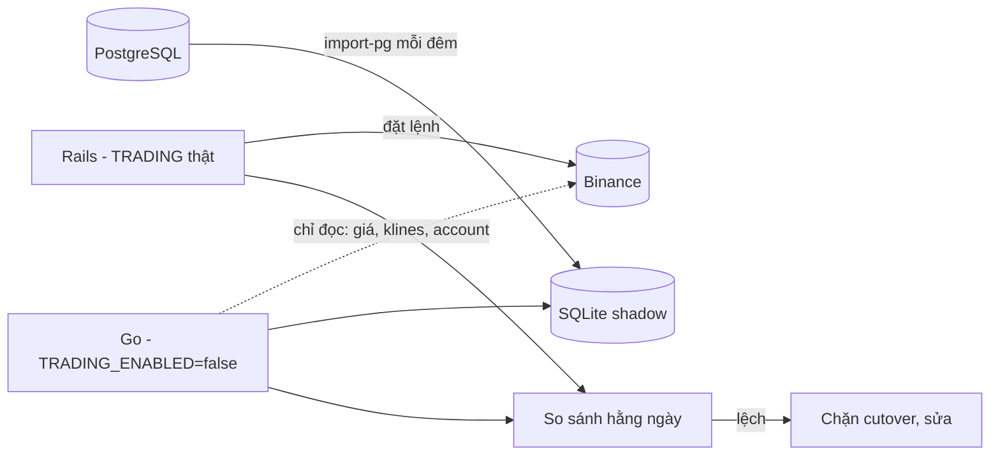

# Di chuyển dữ liệu PostgreSQL → SQLite & cutover

> Thuộc plan [00-overview.md](00-overview.md). Phần này chạm tới tài khoản Binance thật — làm theo checklist, không tắt bước.

## 1. Tool di chuyển dữ liệu: `bwctl import-pg`

- Đọc trực tiếp từ PostgreSQL (`pgx`, connection string qua env) hoặc từ bản restore của dump vào PG local — **không** parse file dump.
- Ghi vào SQLite mới (đã chạy migration goose), trong 1 transaction lớn mỗi bảng, giữ nguyên `id` để FK không đổi.
- Chuyển đổi:
  - decimal → chuỗi decimal chuẩn hoá; timestamp → RFC3339 UTC (Rails lưu UTC, TZ app là `Asia/Ho_Chi_Minh` — kiểm cột `date`/string date không bị lệch ngày).
  - `ema_trades` → tách theo `source`: `EMA1D_EXIT` → `ema1d_positions` (+ dựng `ema1d_orders` từ dữ liệu fill có sẵn); dòng thuộc EMA Settings và EMA legacy → chỉ archive CSV (D1 đã bỏ).
  - `coins`: giữ `description` (markdown), bỏ `market_cap`. `tags`, `coin_tags` → archive.
  - `app_settings` → `strategy_configs`: các key `EMA1D_*` gom vào config `ema1d` (ép sang kiểu đúng bool/int/decimal, validate bằng `ema1d.Config`); `dca` dùng mặc định; key `EMA_{H1,H4,D1}_*` và key mồ côi bỏ — in danh sách key bị bỏ kèm giá trị để đối chiếu.
  - `users.ips` (PG array) → JSON array.
  - Bảng bị bỏ theo D1 (grid, ema_settings, ema legacy, tags, phân tích giá): export CSV vào `archive/` để tra cứu, không import.
- **Đối soát sau import** (lệnh `bwctl verify-import`): đếm dòng từng bảng; tổng realized PnL, tổng fee, tổng notional theo pair/side của EMA1D; số todo theo trạng thái; vị thế đang mở khớp 1-1. Lệch → dừng.
- Chạy được nhiều lần (xoá file SQLite tạo lại) để tập dượt.

## 2. Shadow run

- Thời gian: tối thiểu **7 ngày giao dịch liên tiếp không lệch**.
- Mỗi ngày: import lại từ PG → Go chạy `daily_check` (dry) → so sánh signal rows, desired state, todos sinh ra, sizing (qty/notional) với Rails. Script `bwctl shadow-compare` xuất báo cáo, gửi Discord kênh riêng.
- Kiểm thêm: monitor (unrealized PnL, margin level) Go vs Rails sai số < 0.1%.
- Trong lúc shadow, FE mới chạy trên Go (dữ liệu shadow) để dùng thử UI.

## 3. Cutover — checklist

Bước 0 (trước đợt 1): Grid và EMA Settings bị bỏ (D1) — kiểm trên Rails còn setting ACTIVE / trade OPENING-CLOSING nào không; nếu còn thì đóng tay (force close) hoặc chuyển INACTIVE, ghi lại vị thế còn nằm trên Binance để không bị "mồ côi" khi tắt Rails.

Đợt 1 (EMA1D + core). DCA nếu chưa xong thì vẫn chạy ở Rails nhưng **EMA1D phải tắt bên Rails**.

1. Chọn thời điểm: sau khi `daily_check` 07:03 VN đã chạy và hàng đợi todo trống (không có PENDING/RUNNING).
2. Rails: đặt `EMA1D_ENABLED=0`, dừng job EMA1D (sidekiq-scheduler), xác nhận không còn todo RUNNING.
3. Dừng Claude task bên ngoài gọi `/api/ema1d/sync` (hoặc trỏ sang Go nếu vẫn dùng).
4. Backup PG (`pg_dump`) — giữ làm điểm rollback.
5. `bwctl import-pg` → `bwctl verify-import` → OK.
6. Đối chiếu vị thế trên Binance (margin account: nợ từng coin, số dư) với `ema1d_positions` đang mở. Lệch → dừng.
7. **Rotate secrets**: tạo API key Binance mới (whitelist IP server), webhook Discord mới; xoá key cũ sau khi Go chạy ổn. (Key/webhook cũ đã lộ trong git Rails.)
8. Bật Go: `TRADING_ENABLED=true`, `EMA1D_ENABLED=true`, `pause_open=true` (chỉ cho phép CLOSE trong 24h đầu).
9. Theo dõi 1 chu kỳ ngày: daily_check, todo, monitor, snapshot, Discord. OK → `pause_open=false`.
10. Trỏ nginx/Caddy domain sang Go + FE mới. Giữ app cũ ở subdomain read-only 2 tuần.

Đợt 2 (DCA): lặp lại bước 1–9 cho DCA, rồi tắt hẳn Rails + Sidekiq + Redis + PG.

## 4. Rollback

- Trước bước 8: chỉ cần bật lại Rails, không có gì thay đổi trên sàn.
- Sau bước 8: tắt Go (`TRADING_ENABLED=false`) → export các lệnh Go đã đặt (`bwctl export-orders --since`) → nhập tay/rake vào PG → bật lại Rails. Vì vậy mọi lệnh Go đều có bản ghi `exchange_orders` với `client_order_id` prefix `bw_` để truy vết trên Binance.

## 5. Sau cutover

- Dọn: archive repo Rails + app cũ; xoá `wavetrade.dump` và secret khỏi lịch sử git cũ nếu repo còn được chia sẻ.
- Theo dõi 30 ngày: lỗi Sentry, job lỗi, trượt giá EMA1D.
- Viết `bigwaves/docs/` (vận hành, restore backup, xử lý todo FAILED).
