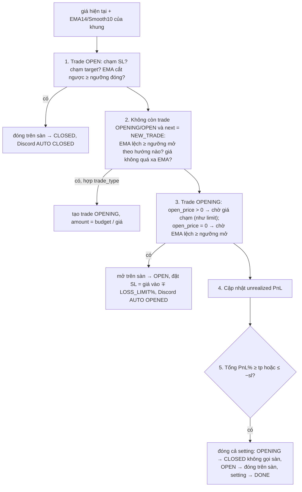
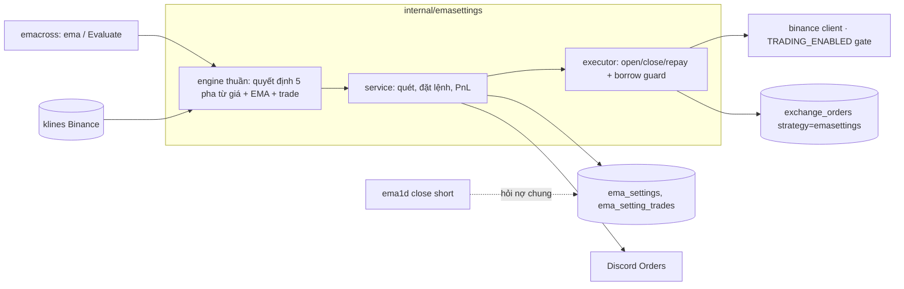
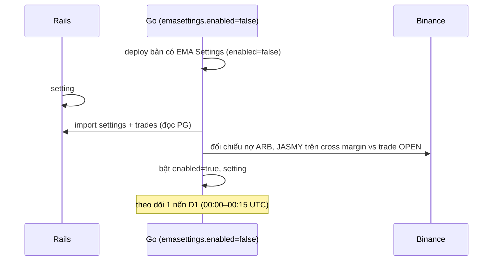

# EMA Settings — chiến dịch EMA cross có ngân sách (port từ Rails)

> Thuộc plan [00-overview.md](00-overview.md) (đổi quyết định "❌ Bỏ" thành port, 2026-10-28).
> Nguồn Rails: `docs/ema-settings.md`, `docs/ema-trading.md`, `app/services/ema_settings/*`,
> `app/services/ema_trades/{open,close}_trade_service.rb`, `app/controllers/api/ema_{settings,trades}_controller.rb`,
> UI `wavetrade-app/src/components/organisms/EmaSetting*`.
> Trạng thái: **E1–E3 xong 2026-10-28** (D-ES1..5 theo đề xuất, mục 7). E4 (cutover) chờ anh — thủ tục ở
> `docs/cutover.md` mục 5. Tài liệu: `docs/ema-settings.md`.

## 1. Vì sao port

Plan ban đầu bỏ EMA Settings. Dữ liệu thật trên Rails (2026-10-28) cho thấy nó vẫn đang chạy:

| | Số |
|---|---|
| Setting | 128 (2 ACTIVE, 10 INACTIVE, 116 DONE); 14 setting có ghi chú |
| Trade | 484: 2 đang giữ (ARB SHORT #2174, JASMY SHORT #2180), 482 DONE |
| Trade tạo tay | 359 / 482 → thao tác tay là phần chính, không phụ |
| Khung | D1 (hiện tại và đa số), H4 (30 setting cũ, đều DONE) |
| PnL đã chốt (gộp, chưa trừ phí) | +186.68 USDT |

Cùng tín hiệu với [EMA cross](../../docs/ema-cross.md) (EMA14 / Smooth10), nhưng **đặt lệnh thật**.

## 2. Nghiệp vụ (giữ như Rails)

Một **setting** = một chiến dịch trên 1 pair: `budget` USDT, `trade_type` ONLY_LONG / ONLY_SHORT / BOTH,
`period` D1 / H4, `check_type` CHECK_AT_OPEN / CHECK_AT_CLOSE / CHECK_AT_CURRENT, `next_trade_type`
NEW_TRADE / NOT_NEW_TRADE, `tp_percent` / `sl_percent` trên tổng PnL so với budget (0 = tắt),
`status` ACTIVE / INACTIVE / DONE, `note` (markdown).

Một **trade**: OPENING (chờ vào, chưa có vị thế) → OPEN (đang giữ; Rails gọi là CLOSING) → CLOSED (Rails: DONE).

### Vòng quét mỗi 5 phút, mỗi setting ACTIVE độc lập

- CHECK_AT_OPEN / CHECK_AT_CLOSE chỉ xét EMA trong **15 phút đầu nến mới** (D1: 00:00–00:15 UTC; H4: giờ chia
  hết 4). SL và target xét mọi lần quét.
- CHECK_AT_CLOSE dùng EMA **tại close của nến vừa đóng**; hai loại kia dùng **giá hiện tại** trên EMA của nến
  vừa đóng (= nến đang chạy).
- Tham số theo khung (Rails AppSetting, giá trị đang dùng):

| | D1 | H4 |
|---|---|---|
| Ngưỡng mở (`OVER_CROSS_EMA_PERCENT_FOR_OPEN`) | 0.03% | 0.03% |
| Ngưỡng đóng (`OVER_CROSS_EMA_PERCENT_FOR_CLOSE`) | 0.03% | 0.03% |
| Bỏ qua khi giá cách EMA ≥ (`CURRENT_OVER_EMA_PERCENT_FOR_IGNORE_OPEN`) | 4% | 3% |
| Stop loss (`LOSS_LIMIT_PERCENT`) | 8% | 5% |

### Đặt lệnh

LONG: market buy spot (pair `is_spot`) hoặc margin. SHORT: luôn margin — vay coin → bán; đóng: mua lại nợ × 1.002
→ trả nợ. Mỗi lệnh có `clientOrderId` cố định nên chạy lại không đặt trùng.

### Thao tác tay (đủ như UI cũ)

CRUD setting, đóng cả setting, ghi chú; thêm trade (OPENING hoặc OPEN với giá/amount nhập tay), sửa trade
(OPENING: chiều, amount, open/target/SL; OPEN: target, amount, SL), xoá trade OPENING, **force open**, **force
close**, **partial close** (tách phần amount ra trade mới rồi đóng), **split** (tách không đóng).

## 3. Khác Rails có chủ đích

| Rails | Go | Lý do |
|---|---|---|
| EMA từ bảng `ema_trackings` (seed tay, cộng dồn) | Tính từ klines Binance như `emacross` (300 nến) | Bỏ được EmaTracking + 3 job cập nhật; không còn pair "quên seed". Giá trị lệch nhỏ so với tracking cũ → đối chiếu ở E3 |
| `CloseSettingService` bọc lệnh sàn trong 1 transaction DB | Đóng từng trade, mỗi trade 1 transaction ngắn; setting → DONE khi mọi trade đã CLOSED | Không gọi Binance trong transaction (rule repo); lỗi giữa chừng không rollback lệnh đã khớp |
| Lỗi 1 bước làm bỏ cả `Each5MinutesSchedule` | Lỗi 1 setting chỉ dừng setting đó, báo Alerts (throttle) | |
| amount lúc tạo = `round_amount` (2–3 chữ số), lúc mở mới floor theo step | Floor theo `step_size` ngay khi mở, kiểm `min_notional` trước khi gọi sàn | Tránh bán/vay lệch step |
| Realized = lãi gộp (không trừ phí, lãi vay) | **Xem D-ES1** | |
| Không có công tắc chung | Thêm `enabled` cho cả chiến lược (config store) | Cutover và tắt khẩn cấp |
| `clientOrderId` = `ema_<id>_open/close` | Trade import giữ nguyên `ema_<id>_*`; trade mới `bw_es_<id>_open/close` | Lệnh Rails đã đặt vẫn được nhận ra, không đặt lại |

## 4. Rủi ro phải xử lý trong code

1. **Nợ coin dùng chung (cross margin).** JASMY đang bị short bởi cả EMA1D (#2165) và EMA Settings (#2180).
   EMA1D hiện chỉ kiểm "position khác cùng short coin" trong `ema1d_positions` rồi trả **toàn bộ** nợ coin
   (`closeShortWithInterest`) → sẽ trả luôn phần nợ của EMA Settings. Sửa: câu kiểm tra phải tính cả trade OPEN
   SHORT của EMA Settings (và ngược lại); EMA Settings đóng short **chỉ trả gốc** khi coin còn bị short ở nơi khác.
2. **Hai hệ cùng quản lý.** Production đang `TRADING_ENABLED=true`. Không bao giờ để setting ACTIVE ở cả Rails lẫn Go
   cùng lúc (thứ tự ở E3).
3. Vay trùng khi retry mở SHORT: dùng lại cơ chế borrow guard của EMA1D (bước BORROWING/BORROWED lưu trên trade).

## 5. Thiết kế

- **Bảng** (migration 00006): `ema_settings` (như Rails + `legacy_id`), `ema_setting_trades` (id giữ nguyên id Rails
  khi import; `side`, `status`, `amount`, `open_price`, `target_price`, `sl_price`, `open_fill`, `close_fill`,
  `fee_usdt`, `interest_usdt`, `realized_profit`, `unrealized_profit`, `is_auto`, `open_order_id`, `close_order_id`,
  `borrow_step`, `last_error`, thời gian). Rails dùng `close_price` vừa là target vừa là giá khớp → tách 2 cột.
- **Config** `emasettings`: `enabled`, theo khung D1/H4: `openPercent`, `closePercent`, `ignoreOverEmaPercent`,
  `stopLossPercent`. Màn Settings + lịch sử thay đổi như các chiến lược khác.
- **Job** `emasettings.check` mỗi 5 phút (singleton), giờ UTC cho cửa sổ nến.
- **Engine thuần** tách khỏi I/O để test bảng (golden) từng pha, từng check_type, cửa sổ 15 phút, ONLY_LONG/BOTH.
- **API** `/api/v1/ema-settings` (list/get/create/update/delete/close, note), `/api/v1/ema-settings/{id}/trades`
  (create), `/api/v1/ema-setting-trades/{id}` (update/delete, `force-open`, `force-close`, `partial-close`, `split`).
  OpenAPI trước, `make gen`.
- **UI** dưới menu **EMA Cross** (xem D-ES3): danh sách setting dạng bảng (pair, khung, chiều, budget, trade đang giữ,
  PnL, %), sheet chi tiết (thống kê, TP/SL, ghi chú, bảng trade + các dialog thao tác tay), form tạo/sửa. Thao tác
  đặt lệnh thật luôn qua ConfirmDialog.

## 6. Các bước

| Bước | Việc | Xong khi |
|---|---|---|
| E1 | Migration, sqlc, config, engine thuần + test bảng, executor (dùng lại helper lệnh của EMA1D: fill, phí, settle, borrow guard), sửa kiểm tra nợ chung ở cả EMA1D và EMA Settings, job | `make test` xanh; test fake Binance: mở/đóng LONG spot/margin, SHORT, retry không đặt trùng, nợ chung JASMY |
| E2 | API + UI (list, chi tiết, form, dialog tay) | E2E smoke: tạo setting, thêm trade tay, force open/close trên fake |
| E3 | `import-pg`: settings + trades (giữ id, `ema_<id>_*`, target/close tách cột, tham số D1/H4 từ AppSetting); `verify-import` thêm đếm + tổng PnL + trade đang giữ; lệnh so EMA klines với `ema_trackings` của 2 pair đang chạy | verify OK, độ lệch EMA không đổi quyết định mở/đóng |
| E4 | Cutover (dưới) | 2 trade ARB, JASMY do Go quản lý, Rails không còn setting ACTIVE |

### Cutover EMA Settings (E4)

Quay lui: Go `enabled=false` → Rails bật lại 2 setting ACTIVE (trade mới Go đặt có `bw_es_*`, export bằng
`bwctl export-orders`).

## 7. Cần anh quyết

| # | Câu hỏi | Đề xuất |
|---|---|---|
| D-ES1 | Realized PnL và TP/SL của setting: lãi **gộp** như Rails hay **ròng** (trừ phí + lãi vay như EMA1D)? | Ròng cho trade mới; trade import giữ số Rails; TP/SL tính trên ròng. Ngưỡng TP/SL cũ sẽ "khó" hơn một chút |
| D-ES2 | Nguồn EMA: klines (như emacross) hay port `ema_trackings`? | Klines |
| D-ES3 | Đặt trong menu EMA Cross (Watchlist · **Campaigns** · Settings) hay menu riêng "EMA Settings"? | Trong EMA Cross, tên "Campaigns" |
| D-ES4 | Giữ khung H4 (không có setting H4 nào đang chạy)? | Giữ — chi phí thấp, engine dùng chung |
| D-ES5 | Giữ đủ partial close / split? | Giữ — 359/482 trade là tay |
