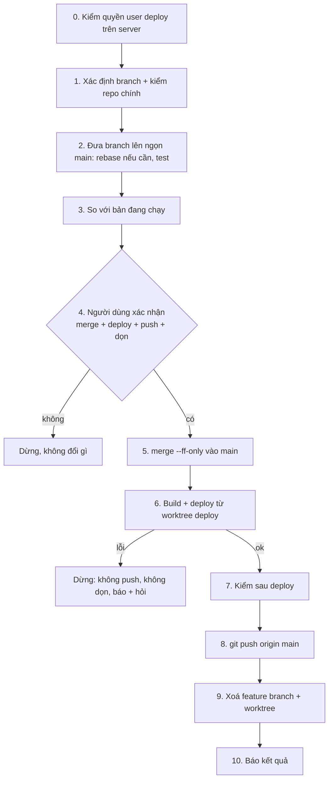

# Deploy bigwaves lên production

Cách deploy đã chốt: `deploy/deploy.sh deploy@167.71.202.249`. Script build trên máy dev rồi upload
binary lên server. Không đề xuất đổi sang cách khác (commit binary, GitHub Release, CI deploy…):
người dùng đã từ chối.

`deploy.sh` tự làm: `make release` (FE build + Go linux/amd64) → upload qua `tar | ssh` → backup DB
→ thay binary (giữ `.prev`) → restart → chờ `/healthz` 30 giây, không lên thì tự quay về `.prev`.
Chi tiết server xem `deploy/README.md`.

| Thứ | Giá trị |
|---|---|
| SSH | `deploy@167.71.202.249` (không dùng `root@`) |
| URL | `https://wavetrade.top:3333` (healthz: `/healthz`) |
| Binary | `/opt/bigwaves/bin/{bigwaves,bwctl}` + `.prev` |
| DB / backup | `/var/lib/bigwaves/bigwaves.db`, `/var/lib/bigwaves/backups/` |
| Env | `/etc/bigwaves/env` |
| Service | `bigwaves` (systemd), log: `journalctl -u bigwaves` (user deploy thuộc group systemd-journal) |
| Repo chính | `/Users/work/Workspace/VH/bigwaves` (checkout của `main`) |



## Không bao giờ

- Chạy `deploy.sh … --setup`: lệnh này chạy lại `setup-debian.sh` và ghi đè `/etc/caddy/Caddyfile`
  (đang sửa tay cho cổng 3333 và redirect www).
- SSH bằng `root@`. User `deploy` chỉ có các quyền ở bước 0; thiếu quyền thì dừng và báo người dùng,
  không chuyển sang root, không xin sudo toàn quyền.
- Sửa `/etc/bigwaves/env`, đổi `TRADING_ENABLED`, bật/tắt switch strategy (ema1d / dca /
  emasettings) như một phần của deploy. Chỉ làm khi người dùng yêu cầu riêng.
- Làm bước 5 trở đi khi chưa được người dùng xác nhận ở bước 4. Một lần đồng ý chỉ áp dụng cho đúng
  branch / commit đó, lần đó. Câu hỏi ở bước 4 phải nói rõ có push `main` và xoá branch, vì đó là
  lời cho phép push duy nhất của lần này.
- Force push dưới mọi hình thức (`--force`, `--force-with-lease`, `-f`), tạo merge commit, hay sửa
  lịch sử `main`. `main` chỉ đi tới bằng fast-forward.
- Push `main` hay xoá branch / worktree khi deploy lỗi hoặc kiểm sau deploy chưa đạt.
- `git worktree remove --force`, `git branch -D`: worktree bẩn hay branch chưa merge thì dừng và hỏi.
- Deploy binary build từ tree có thay đổi chưa commit (`vcs.modified=true`).

## Các bước

```bash
REPO=/Users/work/Workspace/VH/bigwaves
WT=$REPO/.claude/worktrees/deploy          # worktree chỉ dùng để build bản deploy
HOST=deploy@167.71.202.249
```

### 0. Kiểm quyền của user deploy trên server

User `deploy` chỉ có quyền tối thiểu (mục "User `deploy`: quyền tối thiểu" trong
`deploy/README.md`): sở hữu `/opt/bigwaves`, group `systemd-journal`, và sudo không mật khẩu cho
đúng 2 lệnh. Kiểm đủ cả ba:

```bash
ssh -o BatchMode=yes $HOST 'test -w /opt/bigwaves/bin && echo own-ok; \
  sudo -n -l systemctl restart bigwaves >/dev/null && sudo -n -l systemctl start bigwaves-backup.service >/dev/null && echo sudo-ok; \
  id -nG | grep -qw systemd-journal && echo journal-ok'
```

Thiếu dòng nào → dừng, báo người dùng chạy (bằng root, người dùng tự chạy, không tự làm):

```bash
ssh root@167.71.202.249 'set -e
chown -R deploy:deploy /opt/bigwaves
usermod -aG systemd-journal deploy
echo "deploy ALL=(root) NOPASSWD: /usr/bin/systemctl restart bigwaves, /usr/bin/systemctl start bigwaves-backup.service" > /etc/sudoers.d/bigwaves-deploy.tmp
chmod 0440 /etc/sudoers.d/bigwaves-deploy.tmp
visudo -cf /etc/sudoers.d/bigwaves-deploy.tmp && mv -f /etc/sudoers.d/bigwaves-deploy.tmp /etc/sudoers.d/bigwaves-deploy'
```

(Đây là mục "Deploy user" của `setup-debian.sh`. Không chạy lại cả `setup-debian.sh` vì nó ghi đè
Caddyfile.) Không xin sudo toàn quyền cho `deploy`.

`deploy.sh` in `!! out of date, needs root: …` (unit systemd hoặc `/usr/local/bin/bwctl` đổi) → app
vẫn đã restart bằng unit cũ. Báo người dùng kèm lệnh cài bằng root mà script in ra.

### 1. Xác định branch và kiểm repo chính

- Người dùng nêu branch → dùng branch đó. Không nêu → lấy branch của worktree đang làm việc
  (`git branch --show-current`). Đang ở `main` hoặc người dùng chỉ muốn deploy lại → **chế độ chỉ
  deploy**: bỏ bước 2, 5, 9; vẫn push `main` ở bước 8 nếu `main` hơn `origin/main`.
- Tìm worktree của branch: `git -C $REPO worktree list --porcelain` (dòng `branch refs/heads/<b>`).
  Worktree đó phải sạch (`git -C <wt> status --porcelain` rỗng); có thay đổi chưa commit thì hỏi
  người dùng.
- Repo chính phải đang ở `main` và sạch (bỏ qua `?? .claude/worktrees/`):

  ```bash
  git -C $REPO branch --show-current       # main
  git -C $REPO status --porcelain | grep -v '^?? .claude/worktrees/'   # rỗng
  git -C $REPO fetch origin
  git -C $REPO rev-list --left-right --count main...origin/main        # "<hơn> <kém>"
  ```

  `main` kém `origin/main` → `git -C $REPO merge --ff-only origin/main`. Hai phía phân kỳ (cả hơn và
  kém) → dừng, mô tả và hỏi người dùng.

Session bị khoá trong một worktree và harness từ chối lệnh `git -C $REPO …` → dừng, báo người dùng
chạy skill từ session ở repo chính (hoặc tự chạy các lệnh đó).

### 2. Đưa branch lên ngọn main

```bash
git -C $REPO merge-base --is-ancestor main <branch> && echo ff-ok
```

- Không in `ff-ok` (main đã có commit mới sau khi tách branch) → rebase branch trong worktree của nó:
  `git -C <wt> rebase main`. Conflict → `git rebase --abort`, dừng và hỏi người dùng. Branch đã có
  trên origin thì sau rebase không push lại (sẽ cần force) — bước 9 xoá branch remote luôn.
- Chạy test / lint ở worktree của branch (sau rebase nếu có):

  ```bash
  (cd <wt>/frontend && npm ci)   # khi chưa có node_modules hoặc package-lock.json đổi
  make -C <wt> test lint
  ```

  Đỏ → dừng, báo người dùng, không merge.

### 3. So với bản đang chạy

Go nhúng commit vào binary khi build (`vcs.revision`, `vcs.modified`); đọc được bằng `grep -a`,
server không cần `go` hay `strings`:

```bash
ssh $HOST "grep -a -o 'vcs\.\(revision\|modified\|time\)=[^[:space:]]*' /opt/bigwaves/bin/bigwaves | sort -u"
```

Đặt `SHA=$(git -C $REPO rev-parse <branch>)` (chế độ chỉ deploy: `main`). Có `DEPLOYED_SHA` thì:

```bash
git -C $REPO log --oneline $DEPLOYED_SHA..$SHA
git -C $REPO diff --stat $DEPLOYED_SHA..$SHA -- backend/internal/platform/db/migrations
```

- Binary cũ không có `vcs.revision` → ghi "không biết bản đang chạy", bỏ qua so sánh.
- `DEPLOYED_SHA` không phải tổ tiên của `$SHA` → bản mới sẽ **gỡ** những commit đang chạy trên
  server. Nêu rõ ở bước 4.
- Có file migration mới → schema đổi khi app khởi động. Rollback binary không lùi được schema, phải
  restore backup (xem "Rollback").

### 4. Hỏi xác nhận

Dùng `AskUserQuestion`, nội dung tự đứng được:

```
Merge <branch> vào main, deploy production (wavetrade.top:3333), push main, rồi xoá branch + worktree?
  Branch:      <branch> (<N commit>, rebase lên main: có/không)  → main sẽ ở <sha ngắn>
  Đang chạy:   <sha ngắn | không rõ>
  Sẽ lên:      liệt kê subject các commit
  Migration:   <không có | tên file>
  Test/lint:   xanh
  Sau deploy:  git push origin main (<hơn origin bao nhiêu commit>)
  Dọn:         xoá branch local <branch>[, branch remote origin/<branch>], worktree <path>
```

Lựa chọn tối thiểu: làm cả vòng / chỉ merge + deploy (không push, không dọn) / huỷ. Chỉ làm đúng phần
người dùng chọn.

### 5. Merge vào main

```bash
git -C $REPO merge --ff-only <branch>
git -C $REPO rev-parse main      # phải bằng $SHA
```

`--ff-only` lỗi → dừng, không thử kiểu merge khác.

### 6. Build và deploy

Build trong worktree detached cố định, không build trong repo chính hay worktree feature:

```bash
if [ -d $WT ]; then git -C $WT checkout --detach $SHA; else git -C $REPO worktree add --detach $WT $SHA; fi
git -C $WT status --porcelain              # phải rỗng
(cd $WT/frontend && npm ci)                # lần đầu, hoặc khi package-lock.json đổi
cd $WT && deploy/deploy.sh $HOST
```

Build FE + Go mất vài phút: chạy bằng Bash `run_in_background: true`, chờ thông báo xong, không
poll. Sau đó kiểm binary vừa build:

```bash
grep -a -o 'vcs\.\(revision\|modified\)=[^[:space:]]*' $WT/backend/bin/bigwaves | sort -u
```

`vcs.revision` phải bằng `$SHA` và `vcs.modified=false`.

Script exit khác 0 → **dừng**: không push, không dọn. `main` local đã có commit của branch nhưng chưa
lên origin; báo người dùng kèm log script và hỏi hướng xử lý (sửa rồi deploy lại, hay đưa `main` về
`origin/main` bằng `git -C $REPO reset --hard <sha main cũ>` — lệnh này chỉ chạy khi người dùng
đồng ý).

### 7. Kiểm sau deploy

Script in `healthy after Ns` và exit 0 là đã qua `/healthz` nội bộ. Kiểm thêm:

```bash
curl -fsS -o /dev/null -w '%{http_code}\n' https://wavetrade.top:3333/healthz     # 200
ssh $HOST "systemctl is-active bigwaves; \
  grep -a -o 'vcs\.revision=[^[:space:]]*' /opt/bigwaves/bin/bigwaves | sort -u; \
  journalctl -u bigwaves --since '-3min' --no-pager | grep -iE 'error|panic|fatal' | tail -20"
```

- `vcs.revision` trên server phải bằng `$SHA`.
- Log có `panic` / `fatal`, hoặc lỗi lặp lại liên tục → dừng trước bước 8, báo người dùng kèm log,
  hỏi có rollback không.

### 8. Push main

```bash
git -C $REPO push origin main
```

Bị từ chối non-fast-forward (có người push lên `origin/main` trong lúc deploy) → dừng, không force.
Báo `main` và `origin/main` phân kỳ ra sao, nêu lựa chọn (`pull --rebase` rồi push, …) và chờ người
dùng quyết. Lưu ý server đang chạy `$SHA`.

### 9. Xoá feature branch và worktree

Chỉ khi bước 7 và 8 đã đạt:

```bash
git -C $REPO merge-base --is-ancestor <branch> origin/main   # phải đúng trước khi xoá
git -C $REPO worktree remove <wt>                            # không --force
git -C $REPO branch -d <branch>                              # không -D
git -C $REPO push origin --delete <branch>                   # chỉ khi branch có trên origin
git -C $REPO worktree prune
```

- Session hiện tại đang đứng trong `<wt>` → rời worktree trước (`ExitWorktree` với `action: "remove"`
  nếu session tạo ra nó, hoặc `cd` về `$REPO` rồi mới `worktree remove`).
- `worktree remove` báo có thay đổi chưa commit / file untracked → dừng và hỏi, không `--force`.

### 10. Báo kết quả

Báo: commit đã deploy, commit trước đó, các commit đã lên, migration (nếu có), healthz, log có gì
bất thường, `main` đã push tới đâu, branch / worktree đã xoá. Gợi ý người dùng tự mở
`https://wavetrade.top:3333` kiểm phần vừa đổi.

## Rollback

### Script tự rollback

`/healthz` không lên trong 30 giây → script copy `bigwaves.prev` / `bwctl.prev` về, restart, exit 1.
Lúc đó (bước 6 đã dừng, chưa push, chưa dọn):

1. Báo người dùng kèm 40 dòng log script đã in.
2. Có migration trong lần deploy này → DB có thể đã sang schema mới mà binary cũ không hiểu. Hỏi
   người dùng trước khi restore backup (dưới).

### Người dùng muốn quay về bản trước

Hỏi xác nhận rồi mới làm:

```bash
ssh $HOST "cd /opt/bigwaves/bin && cp -p bigwaves.prev bigwaves && cp -p bwctl.prev bwctl && sudo -n systemctl restart bigwaves && sleep 3 && curl -fsS http://127.0.0.1:8080/healthz"
```

Bản vừa deploy đã chạy migration → cần restore backup làm ngay trước lần deploy đó (bản
`backups/bigwaves-*.db.gz` mới nhất có giờ trước lúc deploy). Mất dữ liệu ghi từ lúc deploy tới lúc
restore, nên **luôn hỏi người dùng trước**. Lệnh restore ở mục "Restore một bản backup" trong
`deploy/README.md`. User `deploy` không có quyền làm việc này (dừng service, ghi `/var/lib/bigwaves`): đưa lệnh để người dùng tự chạy bằng `ssh root@167.71.202.249`.

Cách khác (thường tốt hơn khi lỗi nhỏ): sửa lỗi trên branch mới rồi chạy lại skill này.
