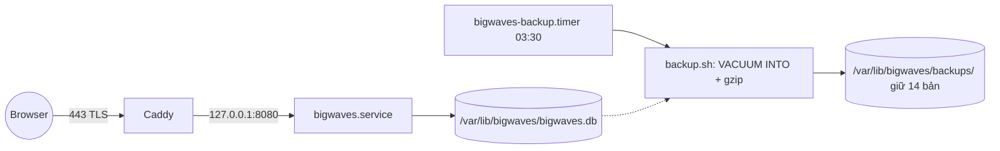

# Deploy production (DigitalOcean droplet, Debian)

Một droplet Debian 12/13 x64, 1 GB RAM. Release là 1 binary Go tĩnh (FE nhúng sẵn) chạy bằng
systemd, Caddy đứng trước lo TLS. Không Docker, không runtime nào khác.



## Các file

| File | Cài vào | Vai trò |
|---|---|---|
| `setup-debian.sh` | chạy 1 lần trên server (chạy lại được) | timezone, swap 1 GB, journald 200 MB, auto security updates, user `bigwaves`, thư mục, units, Caddy |
| `deploy.sh` | chạy từ máy dev | `make release` → upload → backup DB → thay binary (giữ `.prev`) → restart → chờ `/healthz`, lỗi thì rollback |
| `systemd/bigwaves.service` | `/etc/systemd/system/` | chạy app, sandbox chỉ ghi được `/var/lib/bigwaves`, `GOMEMLIMIT=256MiB` |
| `systemd/bigwaves-backup.{service,timer}` | `/etc/systemd/system/` | backup DB mỗi ngày 03:30 giờ VN |
| `backup.sh` | `/opt/bigwaves/bin/` | `VACUUM INTO` (an toàn khi app đang chạy, WAL) → `integrity_check` → gzip, giữ `BACKUP_KEEP` bản (mặc định 14) |
| `bwctl` | `/usr/local/bin/bwctl` | wrapper chạy CLI vận hành dưới user `bigwaves` với env production |
| `Caddyfile` | `/etc/caddy/Caddyfile` | reverse proxy + TLS tự động |
| `nginx.conf` | (tuỳ chọn) | thay cho Caddy nếu muốn nginx + certbot |
| `.env.example` | `/etc/bigwaves/env` | mẫu biến môi trường (dev dùng `.env` ở root repo) |

Đường dẫn trên server:

```
/opt/bigwaves/bin/{bigwaves,bwctl,backup.sh}   binary (+ .prev để rollback)
/opt/bigwaves/deploy/                          bản copy thư mục deploy/ của release gần nhất
/etc/bigwaves/env                              secrets, root:bigwaves 0640
/var/lib/bigwaves/bigwaves.db                  DB
/var/lib/bigwaves/backups/                     backup .db.gz
```

## Lần đầu

1. Tạo droplet: image **Debian** mới nhất, x64, Basic 1 GB, gắn SSH key. Bật DO Backups/Snapshots
   nếu muốn có thêm bản sao cả máy.
2. DO **Cloud Firewall** (không tốn RAM như ufw): inbound 22 (chỉ IP của anh), 80, 443.
   Nếu dùng cổng riêng (vd `example.com:3333`) thì mở thêm cổng đó.
3. Trỏ DNS domain về IP droplet (Caddy cần DNS đúng để lấy cert).
4. Từ máy dev:

   ```bash
   deploy/deploy.sh root@<ip> --setup bigwaves.example.com
   ```

   Script setup server rồi dừng lại vì `/etc/bigwaves/env` chưa có secrets.
5. Trên server: `sudoedit /etc/bigwaves/env` — điền Auth0, Binance, Discord, `EMA1D_API_TOKEN`.
   **Giữ `TRADING_ENABLED=false`** cho tới cutover (`.claude/plans/03-migration-cutover.md`).
6. Deploy thật: `deploy/deploy.sh root@<ip>`. Migration chạy khi app khởi động.
7. Cho phép email đăng nhập: `sudo bwctl user add <email>`.

## Các lần sau

```bash
deploy/deploy.sh root@<ip>
```

Mỗi lần deploy đều backup DB trước (binary mới có thể migrate schema). Nếu `/healthz` không lên
trong 30 giây, script trả binary `.prev` về và in 40 dòng log cuối. Rollback **không** lùi schema:
nếu migration đã chạy thì restore từ backup (dưới đây).

## Vận hành

```bash
systemctl status bigwaves
journalctl -u bigwaves -f                 # log app
sudo bwctl job list                       # job đã đăng ký
sudo bwctl job run <name>                 # chạy job ngay
sudo systemctl start bigwaves-backup      # backup ngay
systemctl list-timers bigwaves-backup     # lần backup kế tiếp
free -m; swapon --show                    # RAM / swap
```

Restore một bản backup:

```bash
sudo systemctl stop bigwaves
cd /var/lib/bigwaves
sudo -u bigwaves mv bigwaves.db bigwaves.db.broken && sudo rm -f bigwaves.db-wal bigwaves.db-shm
sudo -u bigwaves sh -c 'gunzip -c backups/bigwaves-YYYYMMDD-HHMMSS.db.gz > bigwaves.db'
sudo systemctl start bigwaves
```

Nếu đang chạy lại binary cũ sau rollback, restore bản backup tạo ngay trước lần deploy đó (bản mới
nhất trước giờ deploy) để schema khớp với binary.

## Ghi chú

- Backup hiện chỉ nằm trên cùng disk với DB. Backup off-site (Litestream → S3/R2/B2) là pha riêng
  (D5); trước đó DO Backups là lớp bảo vệ duy nhất khi mất cả droplet.
- Muốn dùng nginx thay Caddy: `apt install nginx certbot python3-certbot-nginx`, cài
  `nginx.conf` vào `sites-available`, thay `__SITE__`, `certbot --nginx -d <domain>`, rồi tắt Caddy.
- Đổi kích thước swap: `SWAP_SIZE=2G` khi chạy `setup-debian.sh` (chỉ có tác dụng nếu chưa có swap).
