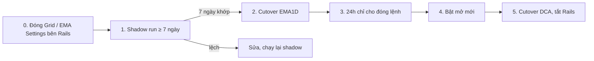

# Chuyển từ Rails sang bigwaves

> Thiết kế: `.claude/plans/03-migration-cutover.md`. Tài liệu này là checklist chạy được, theo đúng thứ tự.
> **Không bao giờ để hai hệ thống cùng đặt lệnh trên một tài khoản Binance.**



## 0. Trước khi bắt đầu

- [ ] Commit branch `ema1d-daily-check` bên Rails (mốc so sánh cố định).
- [ ] Rails: kiểm tra Grid và EMA Settings (đã bỏ ở bản mới) không còn setting ACTIVE hay lệnh đang mở;
      còn thì đóng tay trên Rails và ghi lại.
- [ ] Tạo Auth0 application cho bigwaves, callback `https://wavetrade.top:3333/auth/callback`.

## 1. Shadow run (tối thiểu 7 ngày giao dịch liên tiếp khớp)

Bot chạy bên cạnh Rails với `TRADING_ENABLED=false` và `SCHEDULER_ENABLED=false` (chỉ đọc), trên bản sao
dữ liệu nhập lại mỗi ngày.

Server đã cài theo [deploy/README.md](../deploy/README.md), PostgreSQL của Rails phải truy cập được từ
droplet (user chỉ đọc). Mỗi sáng, sau khi daily check của Rails đã chạy (07:03 VN):

```bash
PG='postgres://readonly:...@<rails-host>/wavetrade'
sudo rm -f /var/lib/bigwaves/shadow.db
sudo bwctl import-pg -pg "$PG" -out /var/lib/bigwaves/shadow.db -archive /var/lib/bigwaves/archive-shadow
sudo bwctl verify-import -pg "$PG" -db /var/lib/bigwaves/shadow.db     # mọi dòng phải OK
# shadow-compare đọc DB_PATH, nên chạy thẳng binary thay vì wrapper (wrapper ép DB production):
sudo -u bigwaves bash -c 'set -a; . /etc/bigwaves/env; set +a; cd /var/lib/bigwaves;
  DB_PATH=/var/lib/bigwaves/shadow.db exec /opt/bigwaves/bin/bwctl shadow-compare -pg "$0" -notify' "$PG"
```

`shadow-compare` so sánh chuỗi tín hiệu (coin, chiều, ngày vào, luật thoát) và danh sách todo mà sync của
Rails tạo với những gì bot tính được (dry run). Có một ngày LỆCH là dừng, tìm nguyên nhân, đếm lại từ đầu.

Trong thời gian này có thể mở giao diện mới trên `shadow.db` để dùng thử.

## 2. Cutover EMA1D

Chọn thời điểm sau 07:05 VN, khi hàng đợi Rails trống.

1. [ ] Rails: `EMA1D_ENABLED=0`, `EMA1D_DAILY_CHECK_ENABLED=0`; dừng Sidekiq job EMA1D; xác nhận không còn todo
       `PENDING`/`RUNNING` (`SELECT status, count(*) FROM ema1d_todos GROUP BY 1`).
2. [ ] Dừng task Claude bên ngoài gọi `/api/ema1d/sync` (hoặc để nó gọi bigwaves cùng đường dẫn, cùng token).
3. [ ] `pg_dump -Fc wavetrade > wavetrade-before-cutover.dump` (điểm quay lui).
4. [ ] Nhập dữ liệu thật (`import-pg` chỉ ghi ra file mới):
       ```bash
       sudo systemctl stop bigwaves && sudo systemctl start bigwaves-backup
       cd /var/lib/bigwaves && sudo -u bigwaves mv bigwaves.db bigwaves.db.pre-cutover
       sudo rm -f bigwaves.db-wal bigwaves.db-shm
       sudo bwctl import-pg -pg "$PG" -out /var/lib/bigwaves/bigwaves.db -archive /var/lib/bigwaves/archive
       sudo bwctl verify-import -pg "$PG" -db /var/lib/bigwaves/bigwaves.db
       ```
5. [ ] Đối chiếu vị thế đang mở (màn EMA1D → Basket / `sudo bwctl ema1d signals`) với tài khoản Binance: nợ từng coin
       (SHORT), số coin đang giữ (LONG).
6. [ ] **Đổi key**: tạo API key Binance mới (whitelist IP, không quyền rút), webhook Discord mới. Key cũ đã
       nằm trong git Rails.
7. [ ] `sudoedit /etc/bigwaves/env`: key mới, `SCHEDULER_ENABLED=true`, **vẫn** `TRADING_ENABLED=false`.
8. [ ] `sudo systemctl start bigwaves`. Màn EMA1D → Settings: bật **Pause new entries**, bật **Execute orders**,
       bật **Daily check**.
9. [ ] `sudoedit /etc/bigwaves/env`: `TRADING_ENABLED=true`; `sudo systemctl restart bigwaves`. Trỏ domain
       (Caddy `__SITE__`) sang bigwaves, giữ app cũ chỉ đọc ở địa chỉ khác 2 tuần.

## 3. 24 giờ đầu

- [ ] Theo dõi: daily check 07:03, hàng đợi, monitor 15 phút, snapshot 07:05, tin Discord.
- [ ] Ổn định → tắt **Pause new entries**.

## 4. Cutover DCA

Lặp lại bước 2 cho DCA (tắt `DcaSettings::CheckTradesService` bên Rails trước), rồi dừng hẳn Rails, Sidekiq,
Redis, PostgreSQL (giữ dump cuối cùng).

## 5. Cutover EMA Settings (Campaigns)

Production đã có dữ liệu sống, nên không import lại cả DB: chỉ chép phần EMA Settings từ một file import mới vào.

1. Deploy bản có migration `00006_emasettings` (bảng rỗng; scan `emasettings.enabled` mặc định **tắt**).
2. Rails: chuyển các setting ACTIVE sang **INACTIVE** (ghi lại id; 2026-10-28 là #140, #144). Từ lúc này Rails ngừng
   quét: SL 8% của 2 trade đang giữ không còn ai canh tới bước 6, nên làm liền mạch.
3. `bwctl import-pg -out <file mới>` (chỉ đọc PG) → `bwctl verify-import` → mọi dòng OK, đặc biệt
   `open EMA Settings trades` và `sum EMA Settings open amount`.
4. Backup DB production (`systemctl start bigwaves-backup`), rồi chép `ema_settings`, `ema_setting_trades` và dòng
   `strategy_configs` `emasettings` từ file import sang (SQLite `ATTACH`, một transaction); đặt lại ACTIVE cho các id
   ghi ở bước 2. Restart app (config được cache).
5. Đối chiếu nợ cross margin trên Binance với trade đang giữ: mỗi coin, nợ = tổng amount SHORT của EMA1D + campaign
   (JASMY: EMA1D #2165 + campaign #2180).
6. Bật scan (EMA Cross → Settings → Campaigns scan). Theo dõi cửa sổ D1 kế tiếp (00:00–00:15 UTC = 07:00–07:15 VN).

Đối chiếu EMA trước khi bật (tuỳ chọn): `bwctl emasettings-compare -pg … -n 5` in EMA14/Smooth10 Rails
(`ema_trackings`) cạnh giá trị tính từ klines cho từng pair đang chạy.

## Quay lui

| Thời điểm | Cách quay lui |
|---|---|
| Trước bước 2.9 | Bật lại Rails; trên sàn chưa có gì thay đổi |
| EMA Settings sau bước 5.6 | Tắt scan campaign; bật lại ACTIVE bên Rails; lệnh bigwaves đã đặt có client id `bw_es_…` (`bwctl export-orders`) |
| Sau bước 2.9 | Tắt bigwaves (`TRADING_ENABLED=false`). `sudo bwctl export-orders -since <giờ cutover>` liệt kê mọi lệnh bigwaves đã đặt (client id `bw_…`); nhập tay các thay đổi vị thế vào Rails rồi bật lại Rails |

Vị thế nhập từ Rails giữ client order id cũ (`ema_<id>_open/close`, `dca_<id>_open/close`): nếu Rails đã đặt
lệnh mà chưa kịp ghi nhận, bigwaves tìm thấy lệnh đó trên Binance thay vì đặt lệnh thứ hai.
