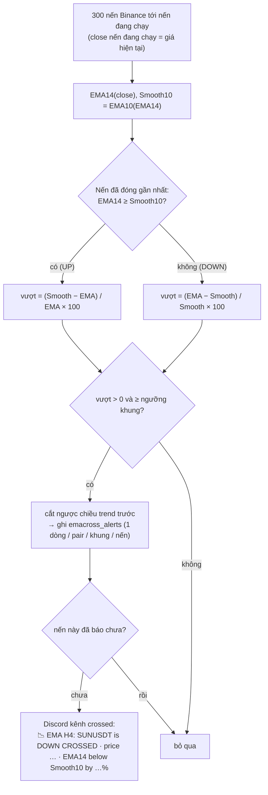

# EMA Cross

> Code: `backend/internal/emacross`. Giao diện: menu EMA Cross. Nguồn Rails:
> `CheckCross{H1,H4,D1}EmasForPairsService` (xem `wavetrade/docs/ema-trading.md`, phần "Cross alert").

Báo Discord khi **EMA14 của giá close** cắt **Smooth10 = EMA10 của EMA14** trên H1, H4 hoặc D1, cho các
pair trong watchlist. **Không đặt lệnh.**

## Luật

- Ngưỡng mặc định 0.01% mỗi khung (EMA Cross → Settings), như `EMA_*_OVER_CROSS_EMA_PERCENT_FOR_OPEN` cũ.
- Pair cần ít nhất 42 nến của khung đó (coin mới niêm yết bị báo lỗi, các pair khác vẫn chạy).
- Chỉ pair `ACTIVE` được kiểm tra. Mỗi lần kiểm tra lưu trend và độ lệch EMA14/Smooth10 để màn Watchlist hiển thị.

## Lịch

| Job | Lịch (UTC) | Ghi chú |
|---|---|---|
| `emacross.check_h1` | phút 01 và 31 mỗi giờ | |
| `emacross.check_h4` | phút 03 mỗi giờ | |
| `emacross.check_d1` | phút 03 (giây 30) mỗi giờ | |
| `emacross.cleanup` | 03:20 VN | Xoá cảnh báo > 90 ngày |

Chạy tay: nút **Check now** trên màn Watchlist, hoặc Admin → Jobs.

## Khác bản Rails

| Rails | bigwaves |
|---|---|
| EMA đọc từ `ema_trackings`, phải seed tay dòng đầu, không seed thì pair không bao giờ được tính | Tính lại từ 300 klines mỗi lần, không cần seed |
| Giá hiện tại = `pairs.current_price` (trễ tới 10 phút) | Close của nến đang chạy |
| Gửi lại mỗi lần chạy khi điều kiện còn đúng | Một tin cho mỗi pair / khung / nến |
| D1 chạy cả trong job hằng giờ lẫn job H4 → gửi 2 tin | Mỗi khung một job |
| Watchlist = cờ `pairs.is_auto_ema_{h1,h4,d1}_trade` | Bảng `emacross_pairs` (tool import mang cờ cũ sang) |
| Bỏ qua pair đang có lệnh legacy CLOSING | Không còn lệnh legacy nên không lọc |
| Webhook viết cứng trong code | `DISCORD_CROSS_WEBHOOK` (trống = chỉ ghi log) |

Khi chạy song song với Rails (shadow run), để trống `DISCORD_CROSS_WEBHOOK` để không nhận mỗi cảnh báo hai lần.
