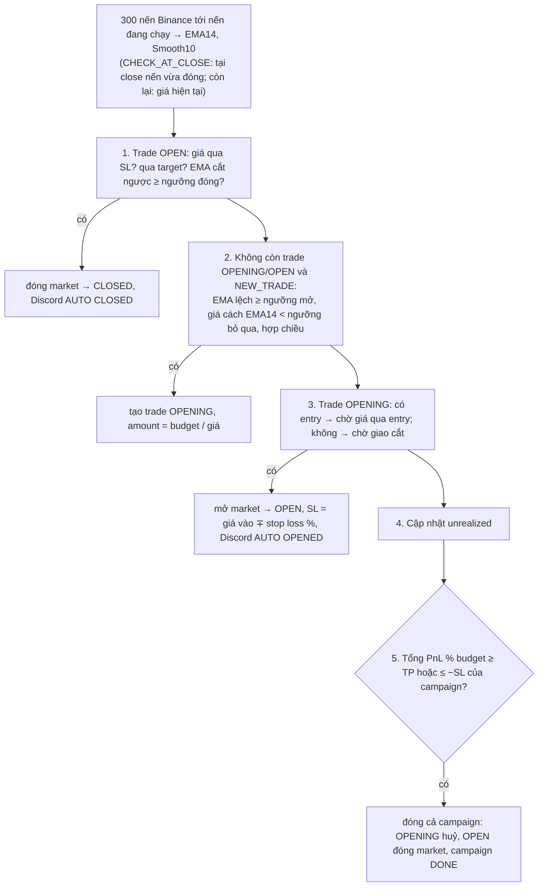

# EMA Settings (Campaigns)

> Code: `backend/internal/emasettings`. Giao diện: EMA Cross → **Campaigns**, ngưỡng ở EMA Cross → Settings.
> Nguồn Rails: `EmaSettings::CheckTradesService` (xem `wavetrade/docs/ema-settings.md`). Plan: `.claude/plans/04-ema-settings.md`.

Một **campaign** (Rails: `EmaSetting`) giao dịch giao cắt **EMA14 của giá close** với **Smooth10 = EMA10 của EMA14**
trên một pair, khung D1 hoặc H4, mỗi lúc một trade, kích thước theo `budget` USDT. **Đặt lệnh thật** (khác EMA Cross
chỉ báo Discord).

## Luật — job `emasettings.check` mỗi 5 phút, mỗi campaign ACTIVE độc lập

- `CHECK_AT_OPEN` / `CHECK_AT_CLOSE` chỉ xét EMA trong **15 phút đầu nến mới** (D1 00:00 UTC, H4 giờ chia hết 4).
  SL / target xét mọi lần.
- Ngưỡng theo khung (Settings, mặc định = giá trị Rails đang dùng):

| | D1 | H4 |
|---|---|---|
| Mở: EMA14 vượt Smooth10 | 0.03% | 0.03% |
| Đóng: cắt ngược | 0.03% | 0.03% |
| Không vào khi giá cách EMA14 ≥ | 4% | 3% |
| Stop loss mỗi trade từ giá vào | 8% | 5% |

- Lệnh: LONG mua spot (pair spot) hoặc cross margin; SHORT luôn cross margin: vay coin (một lần qua mọi lần thử) →
  bán; đóng: mua lại nợ × 1.002 → trả nợ. `clientOrderId` = `bw_es_<id>_open|close` (trade import: `ema_<id>_*`).
- **Nợ coin dùng chung**: nợ cross margin tính theo coin. Khi coin còn bị short bởi trade khác (EMA1D hoặc campaign
  khác) thì đóng short **chỉ trả gốc**; không còn ai thì trả cả gốc lẫn lãi. EMA1D xét cả trade của campaign khi kiểm
  tra xung đột short (như Rails).
- PnL **ròng**: trừ phí hai lệnh và lãi vay (trade import giữ số gộp của Rails).

## Thao tác tay (trang campaign)

| Thao tác | Lệnh sàn |
|---|---|
| Thêm trade "Waiting" (entry hoặc chờ cross) / "Already held" (ghi nhận vị thế đang có) | không |
| Sửa amount, entry, target, SL | không |
| Open now / Close now | market |
| Close part: tách amount sang trade mới rồi đóng phần đó | market |
| Split: tách amount sang trade mới | không |
| Closed by hand on Binance: ghi nhận đã đóng ở giá nhập | không |
| End campaign: huỷ OPENING, đóng OPEN, campaign DONE | market |

Trade OPENING đã gửi lệnh vay (`borrowStep` BORROWING/BORROWED) không xoá / huỷ được: mở nó hoặc trả nợ tay trước.

## Khác bản Rails

| Rails | bigwaves |
|---|---|
| EMA từ `ema_trackings` (seed tay, cộng dồn) | 300 klines mỗi lần; đối chiếu: lệch ≤ 0.0003% trên nến đã chốt (`bwctl emasettings-compare`) |
| `close_price` vừa là target vừa là giá khớp | `target_price` và `close_price` tách cột (`entry_price` / `open_price` cũng vậy) |
| Đóng cả setting bọc lệnh sàn trong 1 transaction DB | Đóng từng trade; lỗi giữa chừng giữ setting ACTIVE để thử lại, lệnh đã khớp không bị "quên" |
| Một bước lỗi bỏ cả `Each5MinutesSchedule` | Lỗi một campaign chỉ dừng campaign đó (báo Alerts, throttle theo trade) |
| Không có công tắc chung | `enabled` (Settings), mặc định tắt sau import |
| PnL gộp | PnL ròng |

## Cutover

Xem [cutover.md](cutover.md) mục "EMA Settings". Không bao giờ để campaign ACTIVE ở cả Rails lẫn bigwaves cùng lúc.
