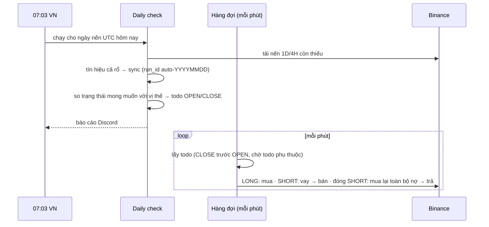

# EMA1D-EXIT

> Code: `backend/internal/ema1d` (engine thuần ở `engine/`). Giao diện: menu EMA1D.

## Chiến lược

| Mục | Luật |
|---|---|
| Nến | 1D Binance, mở lúc 00:00 UTC (07:00 VN) |
| Chỉ báo | EMA14 của giá **open**; Smooth10 = EMA10 của EMA14 (kiểu pandas `ewm(adjust=False)`) |
| Vào | LONG khi EMA14 cắt lên Smooth10, SHORT khi cắt xuống; giá vào = open của nến đó |
| Lọc LONG | Không mở LONG khi biến động 30 ngày của coin ≥ `maxLongVolPct` (mặc định 6%), xem bên dưới |
| Khởi động | Cần > 40 nến 1D (EMA không cắt warm-up, tín hiệu chỉ xét từ nến thứ 41) |
| Thoát | XO: cắt ngược chiều, thoát ở open nến đó. DIV4H (chỉ LONG): xem bên dưới. SHORT luôn thoát XO |
| Luật thoát LONG | Theo từng coin (`long_exit_rule`): BTC dùng XO, các coin khác dùng DIV4H |
| Rủi ro | Không stop loss, không take profit. Một lệnh mỗi pair |
| Phí | Engine trừ 0.1% mỗi chiều (phí giao dịch Binance), xem bên dưới |
| Khối lượng | % của vốn chiến lược (ngân sách + lãi/lỗ đã chốt), cùng một mức cho mọi coin: LONG 5,875%, SHORT 2,9375% |
| Trần | Tổng vốn LONG ≤ vốn chiến lược; USDT free ≥ khối lượng × 1.01 |

### Thoát DIV4H

```
LONG đang mở (từ nến vào e đến trước nến XO)
 └ với mỗi đỉnh fractal 1D p ≥ e (high[p] > 2 nến trước, ≥ 1 nến sau; xác nhận ở nến p+1)
    └ nến 4H cuối cùng đóng trước hết ngày p+1 có cờ phân kỳ âm?
        cờ phân kỳ âm 4H = trong 18 nến 4H gần nhất có xác nhận:
          đỉnh fractal 4H (2 trái / 2 phải) cao hơn đỉnh fractal 4H trước đó (cách ≤ 30 nến)
          nhưng RSI14 (max của nến đỉnh và nến trước) thấp hơn; xác nhận ở nến đỉnh + 2
        → đếm; đỉnh thứ 2 đạt → bán ở open nến 1D kế tiếp (p+2)
 └ không đủ 2 đỉnh trước XO → thoát XO
Nến vào sớm hơn nến 4H đầu tiên + 10 ngày (thiếu dữ liệu 4H) → dùng XO
```

### Phí

Hằng `Fee = 0.001` trong `engine/strategy.go` là phí giao dịch Binance, **0.1% mỗi lượt** (mua hoặc bán). Nó chỉ
dùng để tính **% lãi của lệnh theo chiến lược** (cột Lãi, dòng `ĐÓNG … x%` trong trạng thái và báo cáo):
`lãi = chiều × (giá thoát / giá vào − 1) − 2 × 0.1%`. Phí không ảnh hưởng tín hiệu vào/ra hay khối lượng lệnh thật.
Con số này chưa tính trượt giá và lãi vay (SHORT); lãi/lỗ thật lấy theo giá khớp của vị thế.

Script Python gốc (`tradingview-ema/ema-1d-exit/engine.py`) và các backtest của nó dùng 0.06% mỗi chiều (phí +
trượt giá), nên % lãi của engine thấp hơn số trong report backtest khoảng 0.08% mỗi lệnh.

Dữ liệu vàng `expected_status.json` được sinh từ `status.py` với `engine.FEE = 0.001` (không sửa repo Python):
trỏ `engine.D` vào `testdata/`, cấu hình ETH (LONG DIV4H + SHORT XO) và BTC (chỉ LONG, XO), gọi
`status_rows(cfg, end=ngày+1)` cho từng ngày trong file, ghi JSON `indent=1, ensure_ascii=False`. Chạy cùng
cách với `FEE = 0.0006` ra đúng từng byte file vàng cũ. Đổi phí lần nữa thì sinh lại file theo cách này.

## Rổ coin

Seed tháng 10/2026 (`seed.go`, chỉ tạo dòng còn thiếu, sửa trên màn hình được giữ nguyên):

| Nhóm | Coin | % LONG | % SHORT |
|---|---|---|---|
| Lõi (`CORE`) | JASMY, WLD, RAY, GRT, SUN, BONK, THETA, STX, SEI, RENDER, ETH, FLOKI, PEPE, ZEC, ARB | 5.875 | 2.9375 |
| Nhạy (`SENSITIVE`) | AR, BTC, FET, RUNE, CFX | 5.875 | 2.9375 |

Từ 21/11/2026 hai nhóm dùng chung một mức size (trước đó lõi 7/3.5, nhạy 2.5/1.25; tổng vốn khi đủ 20 lệnh
giữ nguyên 117.5% LONG, 58.75% SHORT). Nghiên cứu `tradingview-ema/ema-1d-exit/review2611` cho thấy cách chia
nhóm không dự báo được: nhóm lõi chỉ hơn nhóm nhạy ở đúng giai đoạn dùng để chia nhóm (10/2023–10/2026); từ
01/2022 chia tầng +1058% và chia đều +1005% là ngang nhau. Cột `pair_group` và 4 ô % trong Settings vẫn giữ
để chia lại nếu cần.

- Chỉ LONG: BTC, ZEC. LONG thoát XO: BTC (còn lại DIV4H).
- % là mức gợi ý (cùng tổng vốn với cấu hình "4d" của backtest), cũng là mặc định; ngân sách mặc định 6000 USDT, tuổi tín hiệu
  tối đa 1 ngày, margin level cảnh báo 1.5 / báo động 1.3.
- Đặt % thấp hơn mức gợi ý được coi là chạy thử: lệnh dưới mức tối thiểu của Binance được nâng lên mức tối
  thiểu × 1.1. Bằng hoặc cao hơn mức gợi ý mà vẫn dưới mức tối thiểu thì lệnh FAILED.

Engine được kiểm bằng dữ liệu vàng `expected_status.json` sinh từ script Python gốc (14 ngày, có cả thoát
DIV4H). Mọi phép nhân cộng được làm tròn riêng (`float64(...)`) để Go không gộp thành FMA (lệch bit so với
pandas).

## Luồng hằng ngày



## Sync: đối chiếu

| Vị thế hiện có | Chiến lược muốn | Hành động |
|---|---|---|
| Không | Đứng ngoài | Không gì |
| Không | L/S, tín hiệu còn mới | OPEN |
| L/S cùng chiều, cùng (hoặc sau) ngày vào | cùng | Giữ (ngày sau = vào trễ, cảnh báo `late_entry`) |
| L/S cùng chiều, ngày vào cũ hơn | cùng | CLOSE rồi OPEN (chiến lược đã thoát và vào lại) |
| L/S | chiều ngược | CLOSE rồi OPEN chiều mới (OPEN phụ thuộc CLOSE) |
| L/S | Đứng ngoài | CLOSE |
| OPEN chưa từng gửi lên sàn | thay đổi | Huỷ OPEN đó thay vì đóng |

Không mở mới khi: pair không ACTIVE, chiều không cho phép/Binance không cho vay, ngày vào trước
`added_on`, tín hiệu cũ hơn `maxEntryAgeDays`, đang tạm dừng mở mới, hoặc LONG bị bộ lọc biến động chặn.
Lệnh đóng luôn chạy.

### Bộ lọc biến động cho LONG

Sync không tạo OPEN LONG khi coin đang biến động quá mạnh (lý do bỏ qua `long_vol_too_high (30d 7.2% >= 6%)`):

- **Biến động** = độ lệch chuẩn (tổng thể) của 30 lợi suất log theo giá close, lấy từ 31 nến 1D đã đóng ngay
  trước nến vào lệnh (`engine.LogReturnStdev`). 6% nghĩa là 30 ngày qua coin dao động cỡ ±6% mỗi ngày.
- Tính tại **nến vào lệnh của chiến lược**, nên một tín hiệu đã bị chặn thì các lần sync sau vẫn bị chặn; coin
  đứng ngoài tới tín hiệu kế tiếp. Không vào bù khi biến động hạ xuống.
- Chỉ áp cho OPEN LONG do sync tạo. SHORT, CLOSE (kể cả CLOSE của một lần đảo chiều) và todo tạo tay không bị
  lọc. Engine và báo cáo trạng thái chiến lược không đổi: dòng trạng thái vẫn ghi LONG, phần "bỏ qua" của sync
  cho biết lệnh không được mở.
- Thiếu nến (31 nến trước ngày vào không liền nhau tới hôm trước) thì không lọc và sync cảnh báo
  `long_vol_unknown`.
- `maxLongVolPct = 0` tắt bộ lọc.

Cơ sở (`tradingview-ema/ema-1d-exit/review2611/REPORT_REVIEW_2611.md`, dữ liệu Binance 01/2022 → 11/2026):
LONG vào lúc biến động ≥ 6% thắng 28% (lệnh còn lại 41%), lãi TB −1,0% so với +8,9%. Rổ 20: Sharpe 1,92 so
với 1,69, MaxDD −21% so với −23%. Cửa sổ ngắn hơn 30 ngày kém hơn (5–10 ngày còn có hại) vì nó đo chính cú
bứt giá tạo tín hiệu. Hạn chế đã biết: trên rổ 20 phần lợi về lãi dồn nhiều vào năm 2024, và ở thị trường
tăng mạnh kiểu 2020–2021 bộ lọc bỏ mất một số lệnh thắng lớn.

## Hàng đợi

Lỗi tạm thời (mạng, Binance bận, -1003, -3045…) thử lại sau 1, 2, 5, 10, 30, 60 phút; quá 10 lần hoặc 12 giờ
thì FAILED. Lỗi vĩnh viễn (vốn, xung đột, lệnh bị sàn từ chối) FAILED ngay. Một OPEN SHORT đã vay mà không bán
được sẽ trả lại coin trước khi FAILED. Vay được bảo vệ bởi bước `BORROWING/BORROWED`: mất phản hồi vẫn tra được
lịch sử vay, không vay lần hai.

## Cấu hình

Màn EMA1D → Settings (mọi thay đổi có lịch sử). Thực thi lệnh, tạm dừng mở mới, daily check, ngân sách,
% khối lượng, tuổi tín hiệu, ngưỡng biến động cho LONG, ngưỡng margin level.
