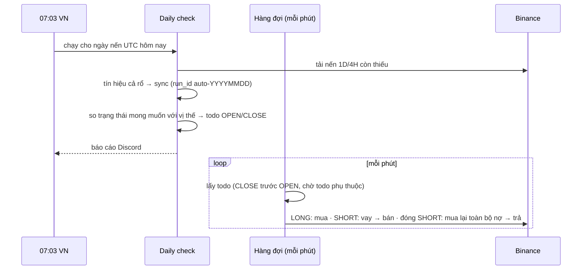

# EMA1D-EXIT

> Code: `backend/internal/ema1d` (engine thuần ở `engine/`). Giao diện: menu EMA1D.

## Chiến lược

| Mục | Luật |
|---|---|
| Nến | 1D Binance, mở lúc 00:00 UTC (07:00 VN) |
| Chỉ báo | EMA14 của giá **open**; Smooth10 = EMA10 của EMA14 (kiểu pandas `ewm(adjust=False)`) |
| Vào | LONG khi EMA14 cắt lên Smooth10, SHORT khi cắt xuống; giá vào = open của nến đó |
| Thoát | XO: cắt ngược chiều. DIV4H (chỉ LONG): đỉnh fractal 1D thứ 2 có phân kỳ âm RSI14 trên 4H → thoát ở open nến 1D kế tiếp |
| Rủi ro | Không stop loss, không take profit. Một lệnh mỗi pair |
| Khối lượng | % của vốn chiến lược (ngân sách + lãi/lỗ đã chốt), theo nhóm Lõi/Nhạy × LONG/SHORT |
| Trần | Tổng vốn LONG ≤ vốn chiến lược; USDT free ≥ khối lượng × 1.01 |

Engine được kiểm bằng dữ liệu vàng `expected_status.json` sinh từ script Python gốc (14 ngày, có cả thoát
DIV4H). Mọi phép nhân cộng được làm tròn riêng (`float64(...)`) để Go không gộp thành FMA (lệch bit so với
pandas).

## Luồng hằng ngày

## Sync: đối chiếu

| Vị thế hiện có | Chiến lược muốn | Hành động |
|---|---|---|
| Không | Đứng ngoài | Không gì |
| Không | L/S, tín hiệu còn mới | OPEN |
| L/S cùng chiều, cùng (hoặc sau) ngày vào | cùng | Giữ (ngày sau = vào trễ, cảnh báo `late_entry`) |
| L/S cùng chiều, ngày vào cũ hơn | cùng | CLOSE rồi OPEN (chiến lược đã thoát và vào lại) |
| L/S | chiều ngược | CLOSE rồi OPEN chiều mới (OPEN phụ thuộc CLOSE) |
| L/S | Đứng ngoài | CLOSE |
| OPEN chưa từng gửi lên sàn | thay đổi | Huỷ OPEN đó thay vì đóng |

Không mở mới khi: pair không ACTIVE, chiều không cho phép/Binance không cho vay, ngày vào trước
`added_on`, tín hiệu cũ hơn `maxEntryAgeDays`, hoặc đang tạm dừng mở mới. Lệnh đóng luôn chạy.

## Hàng đợi

Lỗi tạm thời (mạng, Binance bận, -1003, -3045…) thử lại sau 1, 2, 5, 10, 30, 60 phút; quá 10 lần hoặc 12 giờ
thì FAILED. Lỗi vĩnh viễn (vốn, xung đột, lệnh bị sàn từ chối) FAILED ngay. Một OPEN SHORT đã vay mà không bán
được sẽ trả lại coin trước khi FAILED. Vay được bảo vệ bởi bước `BORROWING/BORROWED`: mất phản hồi vẫn tra được
lịch sử vay, không vay lần hai.

## Cấu hình

Màn EMA1D → Settings (mọi thay đổi có lịch sử). Thực thi lệnh, tạm dừng mở mới, daily check, ngân sách,
% khối lượng, tuổi tín hiệu, ngưỡng margin level.
