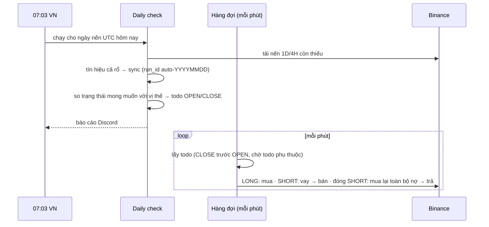

# EMA1D-EXIT

> Code: `backend/internal/ema1d` (engine thuần ở `engine/`). Giao diện: menu EMA1D.

## Chiến lược

| Mục | Luật |
|---|---|
| Nến | 1D Binance, mở lúc 00:00 UTC (07:00 VN) |
| Chỉ báo | EMA14 của giá **open**; Smooth10 = EMA10 của EMA14 (kiểu pandas `ewm(adjust=False)`) |
| Vào | LONG khi EMA14 cắt lên Smooth10, SHORT khi cắt xuống; giá vào = open của nến đó |
| Khởi động | Cần > 40 nến 1D (EMA không cắt warm-up, tín hiệu chỉ xét từ nến thứ 41) |
| Thoát | XO: cắt ngược chiều, thoát ở open nến đó. DIV4H (chỉ LONG): xem bên dưới. SHORT luôn thoát XO |
| Luật thoát LONG | Theo từng coin (`long_exit_rule`): BTC dùng XO, các coin khác dùng DIV4H |
| Rủi ro | Không stop loss, không take profit. Một lệnh mỗi pair |
| Phí | Engine trừ 0.06% mỗi chiều (phí + trượt giá, theo script Python gốc), xem bên dưới |
| Khối lượng | % của vốn chiến lược (ngân sách + lãi/lỗ đã chốt), theo nhóm Lõi/Nhạy × LONG/SHORT |
| Trần | Tổng vốn LONG ≤ vốn chiến lược; USDT free ≥ khối lượng × 1.01 |

### Thoát DIV4H

```
LONG đang mở (từ nến vào e đến trước nến XO)
 └ với mỗi đỉnh fractal 1D p ≥ e (high[p] > 2 nến trước, ≥ 1 nến sau; xác nhận ở nến p+1)
    └ nến 4H cuối cùng đóng trước hết ngày p+1 có cờ phân kỳ âm?
        cờ phân kỳ âm 4H = trong 18 nến 4H gần nhất có xác nhận:
          đỉnh fractal 4H (2 trái / 2 phải) cao hơn đỉnh fractal 4H trước đó (cách ≤ 30 nến)
          nhưng RSI14 (max của nến đỉnh và nến trước) thấp hơn; xác nhận ở nến đỉnh + 2
        → đếm; đỉnh thứ 2 đạt → bán ở open nến 1D kế tiếp (p+2)
 └ không đủ 2 đỉnh trước XO → thoát XO
Nến vào sớm hơn nến 4H đầu tiên + 10 ngày (thiếu dữ liệu 4H) → dùng XO
```

### Phí: engine 0.06% so với Binance 0.1%

Hằng `Fee = 0.0006` trong `engine/strategy.go` chỉ dùng để tính **% lãi của lệnh theo chiến lược** (cột Lãi,
dòng `ĐÓNG … x%` trong trạng thái và báo cáo): `lãi = chiều × (giá thoát / giá vào − 1) − 2 × 0.06%`. Phí không
ảnh hưởng tín hiệu vào/ra hay khối lượng lệnh thật.

Phí giao dịch thật trên Binance hiện là **0.1% mỗi lượt** (mua hoặc bán), tức 0.2% cho một lệnh vào + ra,
chưa kể trượt giá và lãi vay (SHORT). Vì vậy % lãi engine báo **cao hơn thực tế ít nhất ~0.08%** mỗi lệnh (0.2%
− 0.12%). Lãi/lỗ thật lấy theo giá khớp của vị thế, không theo con số này. Giữ 0.06% để khớp dữ liệu vàng
của Python; đổi hằng số này thì phải sinh lại `expected_status.json`.

## Rổ coin

Seed tháng 10/2026 (`seed.go`, chỉ tạo dòng còn thiếu, sửa trên màn hình được giữ nguyên):

| Nhóm | Coin | % LONG | % SHORT |
|---|---|---|---|
| Lõi (`CORE`) | JASMY, WLD, RAY, GRT, SUN, BONK, THETA, STX, SEI, RENDER, ETH, FLOKI, PEPE, ZEC, ARB | 7 | 3.5 |
| Nhạy (`SENSITIVE`) | AR, BTC, FET, RUNE, CFX | 2.5 | 1.25 |

- Chỉ LONG: BTC, ZEC. LONG thoát XO: BTC (còn lại DIV4H).
- % là mức gợi ý (cấu hình "4d" của backtest), cũng là mặc định; ngân sách mặc định 6000 USDT, tuổi tín hiệu
  tối đa 1 ngày, margin level cảnh báo 1.5 / báo động 1.3.
- Đặt % thấp hơn mức gợi ý được coi là chạy thử: lệnh dưới mức tối thiểu của Binance được nâng lên mức tối
  thiểu × 1.1. Bằng hoặc cao hơn mức gợi ý mà vẫn dưới mức tối thiểu thì lệnh FAILED.

Engine được kiểm bằng dữ liệu vàng `expected_status.json` sinh từ script Python gốc (14 ngày, có cả thoát
DIV4H). Mọi phép nhân cộng được làm tròn riêng (`float64(...)`) để Go không gộp thành FMA (lệch bit so với
pandas).

## Luồng hằng ngày



## Sync: đối chiếu

| Vị thế hiện có | Chiến lược muốn | Hành động |
|---|---|---|
| Không | Đứng ngoài | Không gì |
| Không | L/S, tín hiệu còn mới | OPEN |
| L/S cùng chiều, cùng (hoặc sau) ngày vào | cùng | Giữ (ngày sau = vào trễ, cảnh báo `late_entry`) |
| L/S cùng chiều, ngày vào cũ hơn | cùng | CLOSE rồi OPEN (chiến lược đã thoát và vào lại) |
| L/S | chiều ngược | CLOSE rồi OPEN chiều mới (OPEN phụ thuộc CLOSE) |
| L/S | Đứng ngoài | CLOSE |
| OPEN chưa từng gửi lên sàn | thay đổi | Huỷ OPEN đó thay vì đóng |

Không mở mới khi: pair không ACTIVE, chiều không cho phép/Binance không cho vay, ngày vào trước
`added_on`, tín hiệu cũ hơn `maxEntryAgeDays`, hoặc đang tạm dừng mở mới. Lệnh đóng luôn chạy.

## Hàng đợi

Lỗi tạm thời (mạng, Binance bận, -1003, -3045…) thử lại sau 1, 2, 5, 10, 30, 60 phút; quá 10 lần hoặc 12 giờ
thì FAILED. Lỗi vĩnh viễn (vốn, xung đột, lệnh bị sàn từ chối) FAILED ngay. Một OPEN SHORT đã vay mà không bán
được sẽ trả lại coin trước khi FAILED. Vay được bảo vệ bởi bước `BORROWING/BORROWED`: mất phản hồi vẫn tra được
lịch sử vay, không vay lần hai.

## Cấu hình

Màn EMA1D → Settings (mọi thay đổi có lịch sử). Thực thi lệnh, tạm dừng mở mới, daily check, ngân sách,
% khối lượng, tuổi tín hiệu, ngưỡng margin level.
