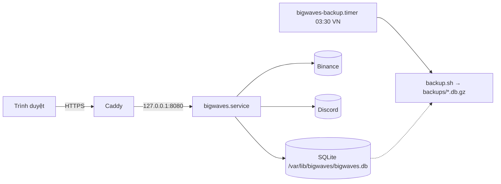

# Vận hành

> Liên quan: [cutover.md](cutover.md) · [ema1d.md](ema1d.md) · [dca.md](dca.md) · [ema-cross.md](ema-cross.md) · [ema-settings.md](ema-settings.md)

## Thành phần

Một binary `bigwaves` chạy cả API (`/api/v1`), giao diện (nhúng sẵn), luồng cập nhật trực tiếp (SSE
`/api/v1/events`) và các job định kỳ. Dữ liệu nằm trong một file SQLite. `bwctl` là công cụ dòng lệnh
cho người vận hành (trên server: `sudo bwctl …`, chạy dưới user `bigwaves` với env production).

Cài server, triển khai, rollback, sao lưu và khôi phục: **[deploy/README.md](../deploy/README.md)**.
Tài liệu này chỉ nói phần ứng dụng.

## Biến môi trường

Xem `deploy/.env.example`. Trên server đặt ở `/etc/bigwaves/env` (`root:bigwaves 0640`,
`setup-debian.sh` tạo sẵn từ mẫu).

| Biến | Ý nghĩa |
|---|---|
| `APP_ENV=production` | Bật log JSON, bắt buộc Auth0, cấm `DEV_USER_EMAIL` |
| `APP_URL` | Địa chỉ công khai, vd `https://wavetrade.top:3333` (callback Auth0 + kiểm Origin) |
| `TRADING_ENABLED` | **Công tắc an toàn**. `false`: không lệnh, vay, trả, chuyển nào lên Binance |
| `SCHEDULER_ENABLED` | Tắt mọi job định kỳ (vd khi chạy song song để đọc) |
| `BINANCE_API_KEY/SECRET_KEY` | Key Binance (whitelist IP server, quyền margin, **không** quyền rút) |
| `AUTH0_*` | Đăng nhập. Callback: `<APP_URL>/auth/callback` |
| `DISCORD_ORDER_WEBHOOK` | Lệnh khớp / lỗi lệnh |
| `DISCORD_ALERT_WEBHOOK` | Job lỗi, margin level, kết quả shadow |
| `DISCORD_REPORT_WEBHOOK` | Báo cáo daily check EMA1D (bắt buộc khi bật daily check) |
| `DISCORD_CROSS_WEBHOOK` | Cảnh báo EMA cross H1/H4/D1 (bỏ trống = chỉ ghi log) |
| `EMA1D_API_TOKEN` | Token cho các endpoint cũ `/api/ema1d/*` (bỏ trống = tắt) |
| `BACKUP_KEEP` | Số bản `backup.sh` giữ lại (mặc định 14) |

Ai được đăng nhập: `sudo bwctl user add <email>` (email phải khớp tài khoản Auth0).

## Dừng và khởi động lại

Khi dừng, app chờ tối đa 30 giây cho job đang chạy (vd một lệnh đang đặt) rồi mới tắt (systemd cho
120 giây). Todo bị gián đoạn giữa chừng được hàng đợi tự nhận lại sau 15 phút, và nhờ client order id
cố định nên không bao giờ đặt trùng lệnh.

Sau khi khôi phục DB từ backup, mọi lệnh khớp sau thời điểm sao lưu không có trong DB: đối chiếu với
Binance (vị thế, nợ margin) trước khi bật lại thực thi lệnh.

## Job định kỳ

Màn **Admin → Jobs** hiện lần chạy cuối/kế tiếp và cho chạy tay. Dòng lệnh: `sudo bwctl job list`,
`sudo bwctl job run <tên>`.

| Job | Lịch | Việc |
|---|---|---|
| `ema1d.process_todos` | mỗi phút | Thực thi hàng đợi EMA1D |
| `ema1d.monitor` | 15 phút | Giá, lãi/lỗ chưa chốt, margin level, nhắc chưa sync |
| `ema1d.daily_check` | 07:03 VN | Nến → tín hiệu → sync → báo cáo |
| `ema1d.daily_snapshot` | 07:05 VN | Ảnh chụp vốn + kiểm tra pair trên Binance |
| `dca.check` | 5 phút | Mua/bán DCA theo giá |
| `emacross.check_h1` | phút 01 và 31 | Cảnh báo EMA cross H1 |
| `emacross.check_h4`, `emacross.check_d1` | phút 03 mỗi giờ | Cảnh báo EMA cross H4, D1 |
| `emasettings.check` | 5 phút (giây 50) | Campaigns: SL / target / cắt ngược, trade mới, TP/SL campaign (bật ở EMA Cross → Settings) |
| `market.update_prices` | 10 phút | Giá mọi pair (một lệnh ticker) |
| `market.update_interest` | mỗi giờ | Lãi vay margin |
| `market.update_filters` | 07:07 VN | Step size, min notional |
| `maintenance.retention` | 03:00 VN | Xoá session hết hạn, lịch sử job > 30 ngày |
| `ema1d.cleanup` | 03:15 VN | Xoá sync dry-run > 30 ngày |
| `emacross.cleanup` | 03:20 VN | Xoá cảnh báo EMA cross > 90 ngày |

Mỗi job lỗi gửi cảnh báo Discord (kênh alerts), cùng một lỗi tối đa 1 lần/10 phút. Sao lưu không phải
job của app mà là `bigwaves-backup.timer` của systemd (xem deploy/README.md).

## Xử lý sự cố thường gặp

| Hiện tượng | Xử lý |
|---|---|
| Todo EMA1D **FAILED** | Đọc `lastError` ở màn EMA1D → Queue. Lỗi vốn/pair (`insufficient_budget`, `conflict`…) thì sửa nguyên nhân rồi Retry. Lỗi Binance (`-2010` thiếu số dư…) kiểm tra tài khoản trước khi Retry |
| Todo OPEN SHORT FAILED với ghi chú "repay by hand" | Coin đã vay nhưng chưa bán và không trả lại được tự động: trả nợ trên Binance, kiểm tra lại vị thế |
| "No sync for today yet" | Màn EMA1D → Equity & reports → Daily check: xem lỗi, bấm "Run daily check now" |
| Badge **Read-only** trên thanh trên cùng | `TRADING_ENABLED=false`: cố ý (chạy song song) hay quên bật |
| Margin level dưới ngưỡng | Giảm SHORT hoặc chuyển thêm USDT vào cross (Account → Spot → Cross) |
